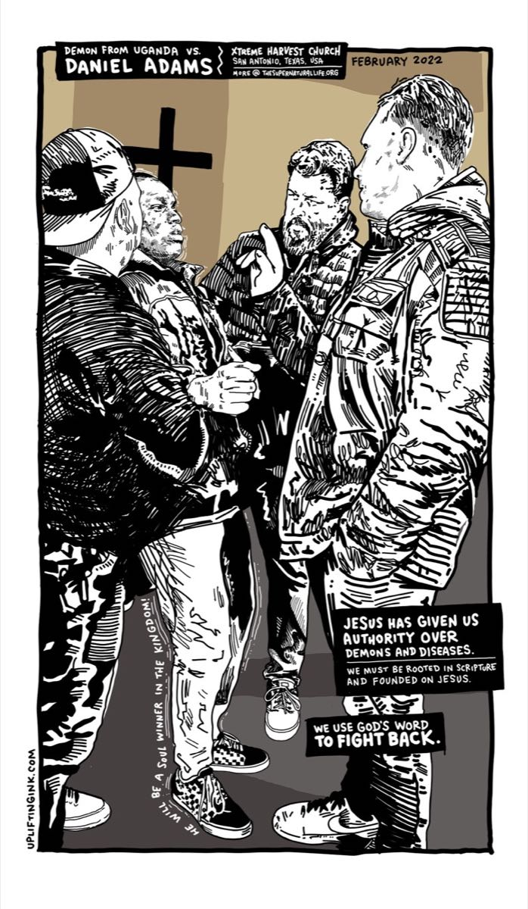
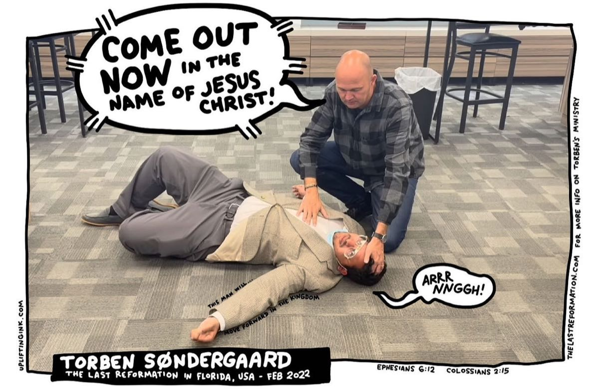

## Demon from Uganda vs. Daniel Adams

Here’s the video that captured a deliverance in San Antonio. I was caught in the middle of it, just helping to make sure the young guy didn’t spill over and hurt himself. After the dust settled, it turns out that he didn’t quite remember anything – he was completely unaware of what was happening. His siblings were in shock as well. Here was their typically quiet brother acting incredibly strange.

Daniel Adams, the founder of The Supernatural Life, was able to lead this family into freedom from this ancient witchcraft spirit. [You can check out the video here on YouTube](https://www.youtube.com/watch?v=L-lkwFqcNJQ). (By the way, this whole situation seemed to “just happen” out of nowhere, but God had a plan. Thankfully, someone had the mindset to start recording.)

## Something Extra

[Since I saw this deliverance video](https://www.youtube.com/watch?v=gzZHLSf0AOs&t=494s) from Torben Søndergaard of The Last Reformation, it seemed like something to work with as well. His entire ministry and life leaves me speechless.

## In Closing

Wow. What’s up with all the deliverance stuff? Not sure, but it became a solid theme and a reason to draw this week. This stuff is strange, but impactful.

Thanks to my daughter and her friends of the super sweet cheering section!

See you next time!
