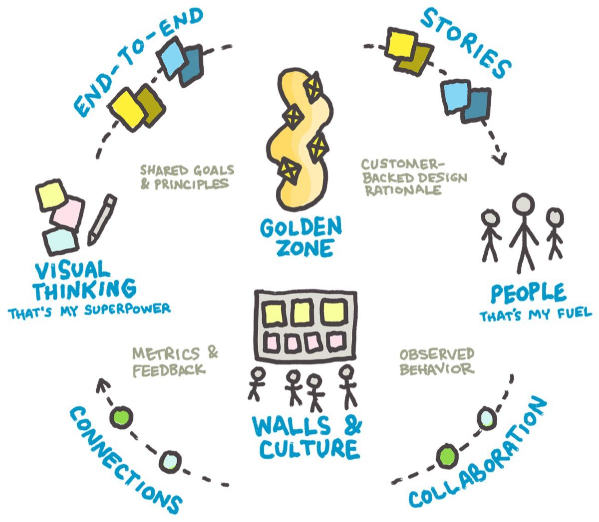

Over the past week, I had a job interview (same company), but ended up dusting off my previous resumé brochure… which is actually a big drawing that maps out my career. It details snippets of my life, interests and jobs over the years.

In both the resumé and my digital portfolio, I used the same two themes: Visual Thinking and People. After the interview, I thought about how everything has been evolving since presenting my work two years ago.

I ended up creating a bigger “current state” graphic, adding a few more themes… including the idea of designers “dreaming out loud” and building a culture through transparency, strong customer-backed design rationale, and shared principles.

Here’s that sketchbook:

Anyway, to “keep going” this week, I created that graphic and a little video that goes along with it.

If you can handle a 9-minute ramble, here’s what I got:

[Watch the video on YouTube](https://www.youtube.com/watch?v=xan8J58g-9Q)

Thanks and hope that you’re well out there.

– Paul
