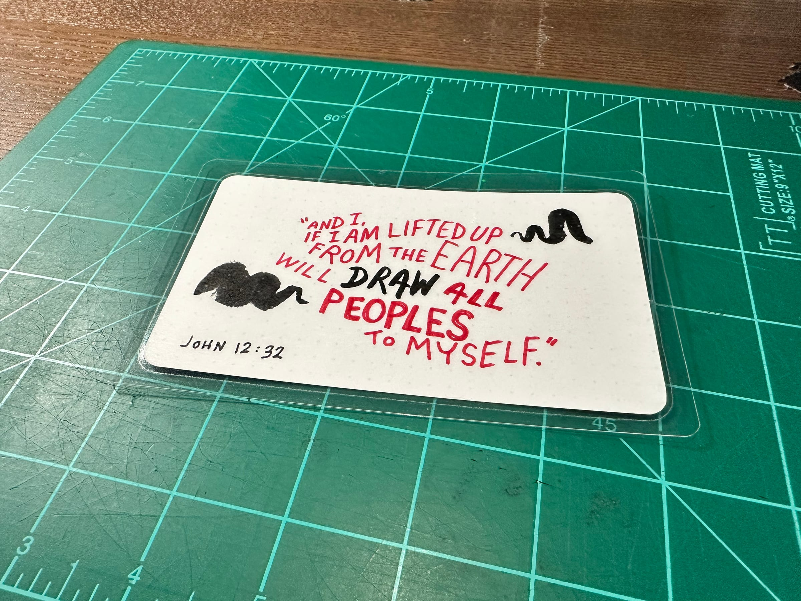
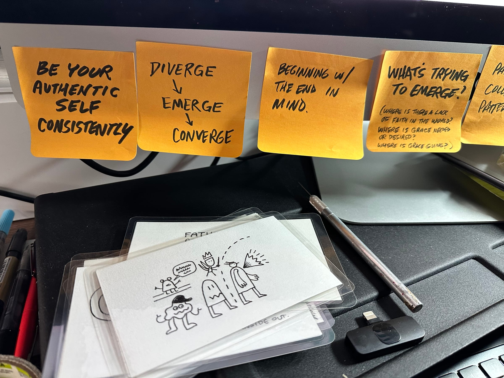
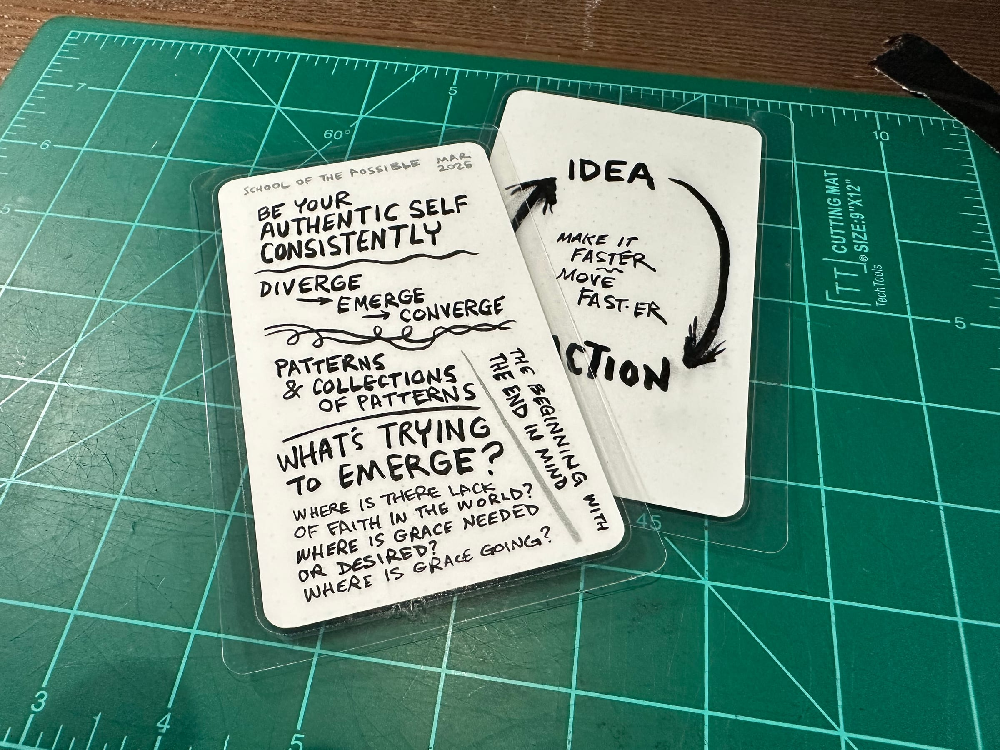

Was looking at a few Bible Notes today and decided to make a video sharing how I laminate them.

<iframe src="https://www.youtube-nocookie.com/embed/5JAcxO9x4dw" title="004 - Laminate the Notes" loading="lazy" allow="accelerometer; clipboard-write; encrypted-media; gyroscope; picture-in-picture; web-share" referrerpolicy="strict-origin-when-cross-origin" allowfullscreen></iframe>

From the video, I shared one of the digital card drawings. Ended up tracing it with ink… and laminated it.

Then, just showing off how I also laminate other things that inspire. Here are some notes from a School of the Possible breakout discussion that I made into a quick card.

