## Why not paint?

I laminated and stuck these notes up on the wall. Then, looked at the canvas painting and realized it was dated 2015. That’s a decade ago. It taunts me.

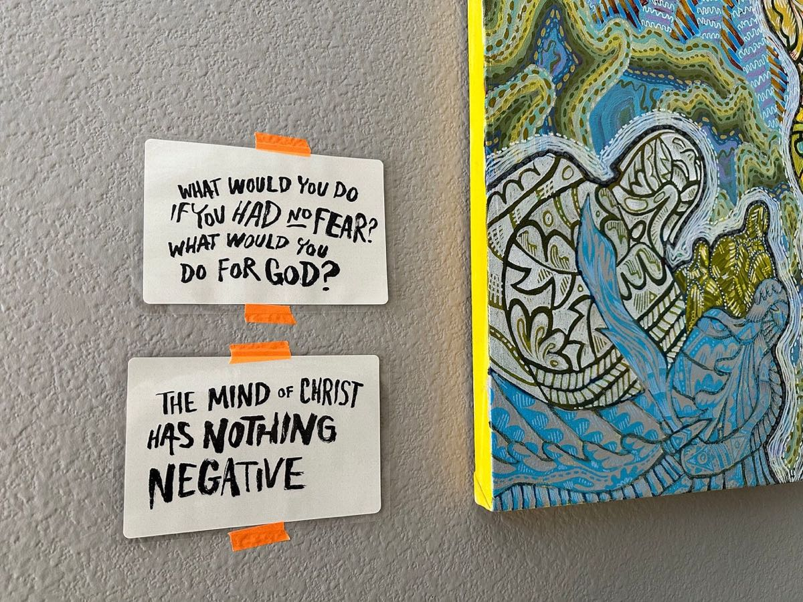

<!-- more -->

Looking back at some old photos, seems like it began in 2013. What? Well, paintings have always taken a while to finish. They are challenging. For this one, I even used photos to figure out possible color schemes.

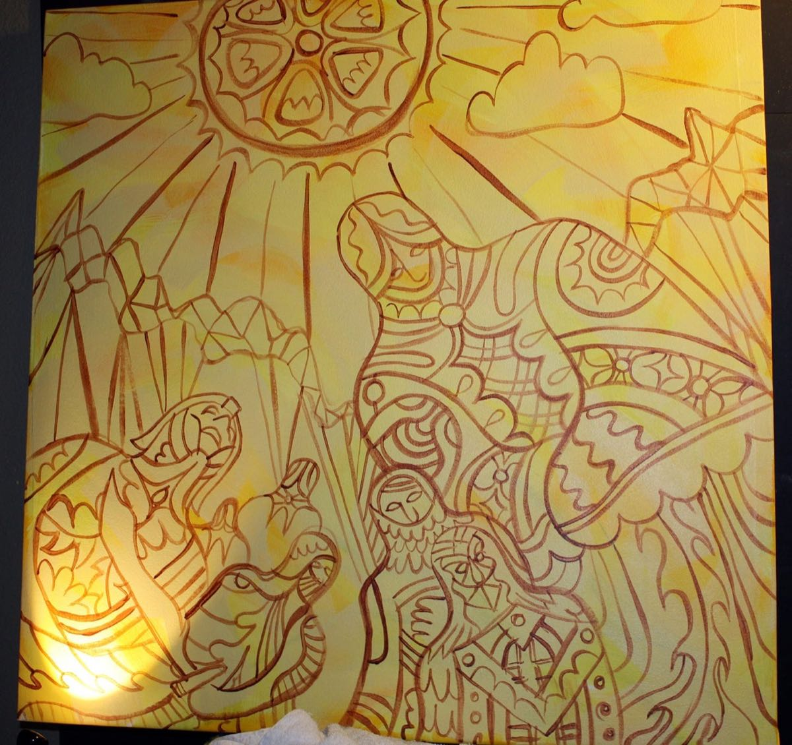

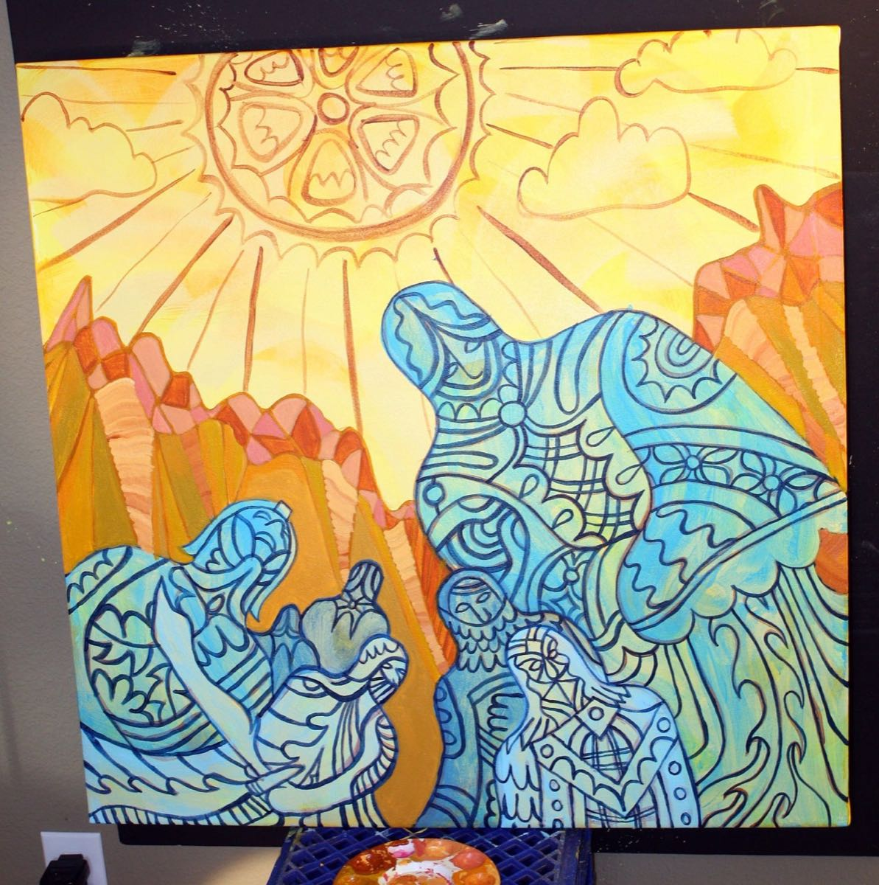

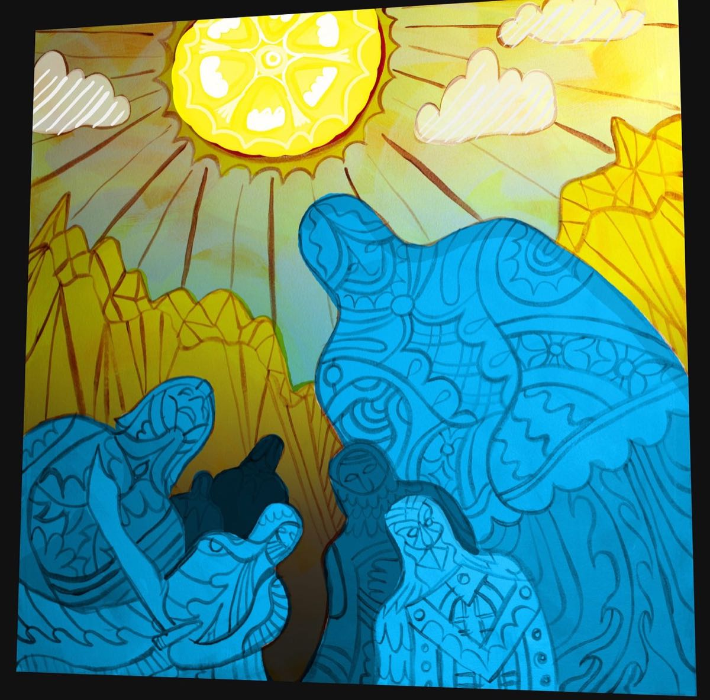

More recently, I did finish this wild one. I let it be about light, disruption, melting and liquid energy. This thing I stewarded for years, but finally called it done in 2023.

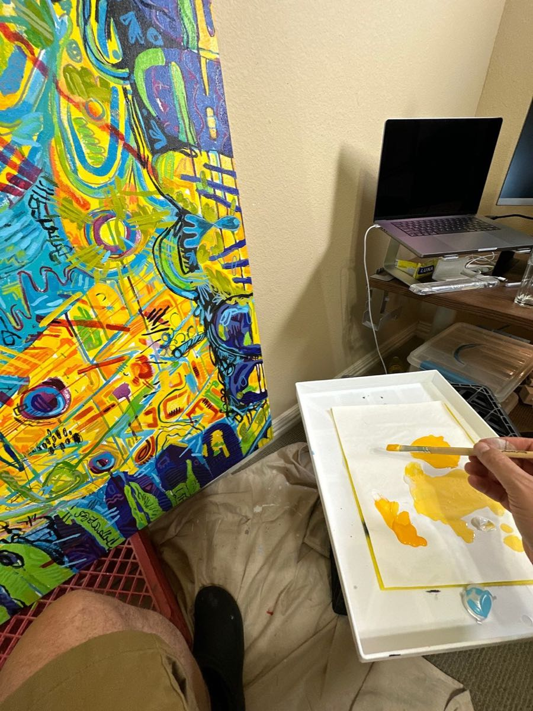

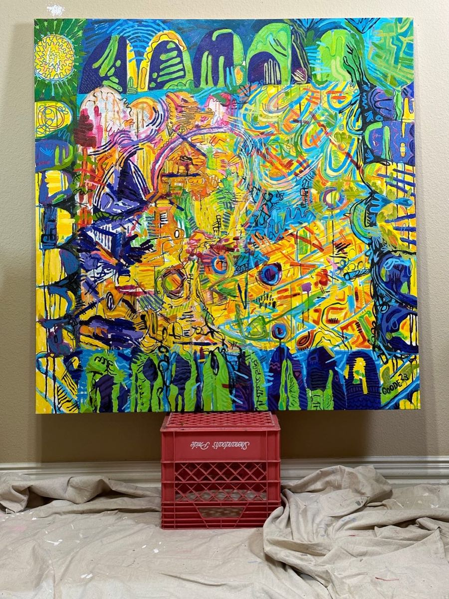

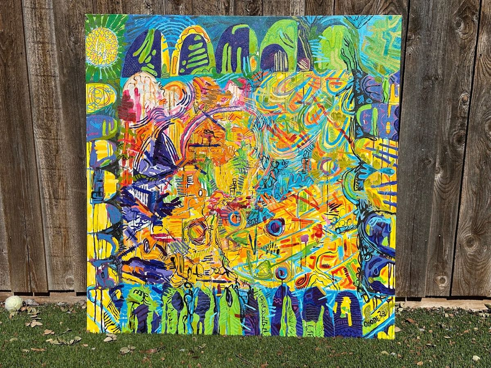

## What is important?

Looking back at my old notes, there have been so many scribbles about my old jobs. All of it seemed important. None of it was.

All these sketches have been fleeting. Technology moves on. I’ve been through 4 layoffs now. The thing that remains consistent is the call from deep within to “go for it.”

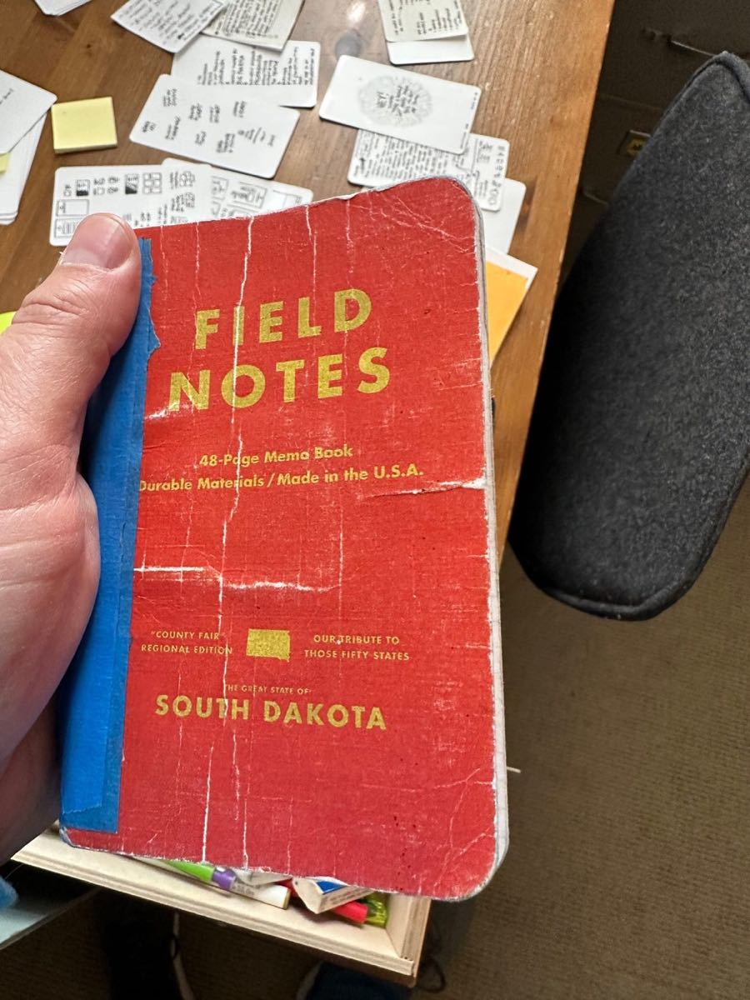

Out of anyone in the world, I’m the only one with my assignment. I’m the only one that has “whatever creative” locked up inside of me that has not seen the light of day… and will never see itself come to life unless it is stewarded into existence.

Time to lean in. Lean into time?

## Stretch

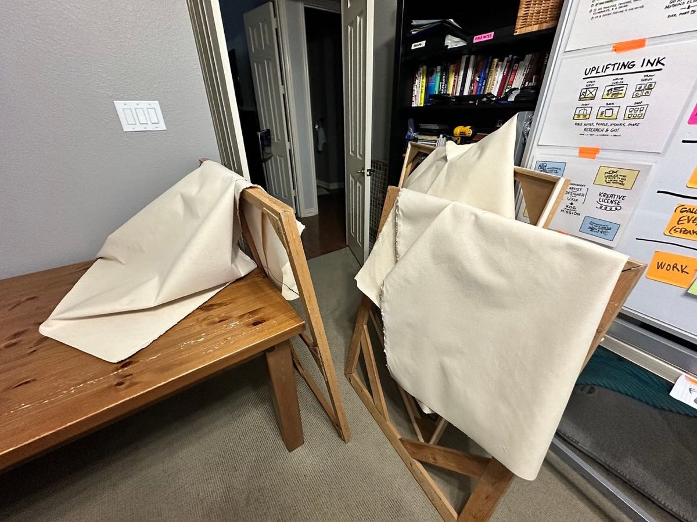

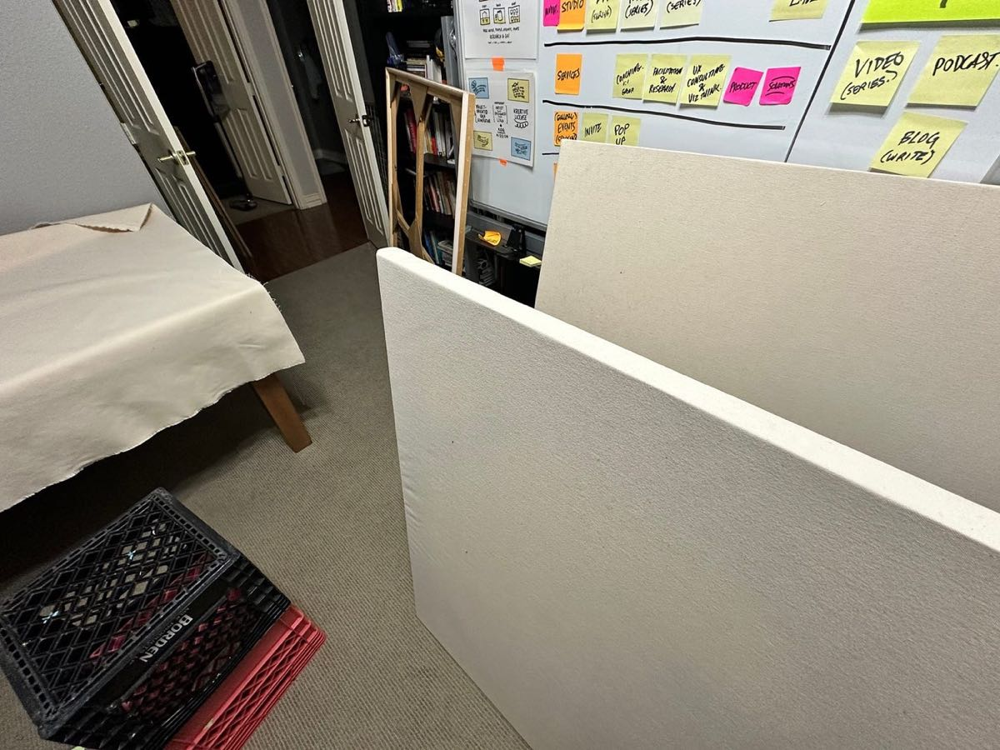

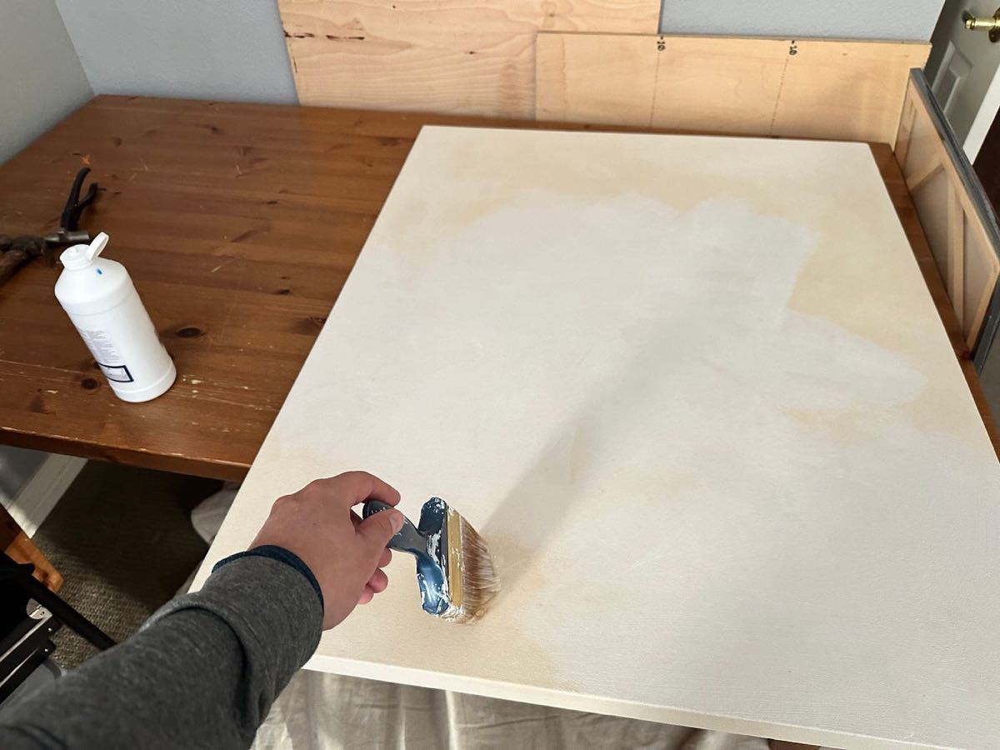

Collected my old handmade stretchers from the garage and attic. Cut canvas, stretched it and applied gesso to prep.

I’ve always imagined myself becoming an old artist that makes paintings.

I looked in the mirror today.

The time has come.

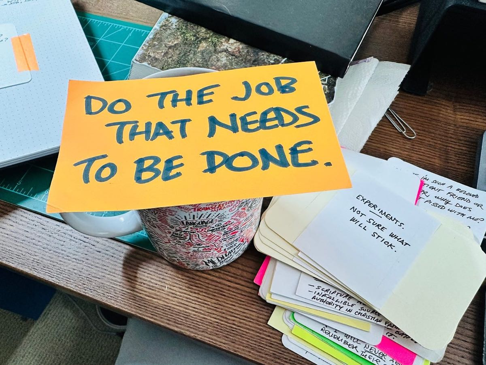
