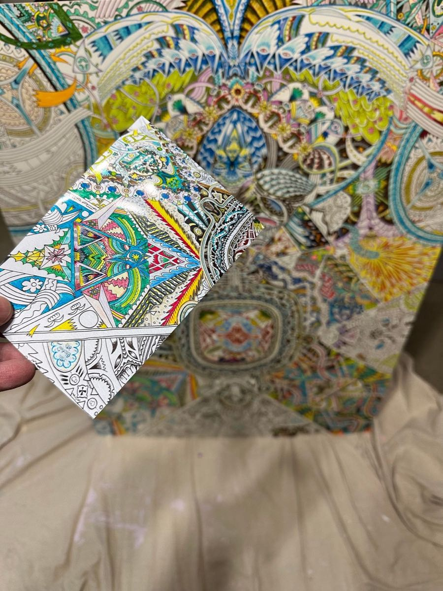
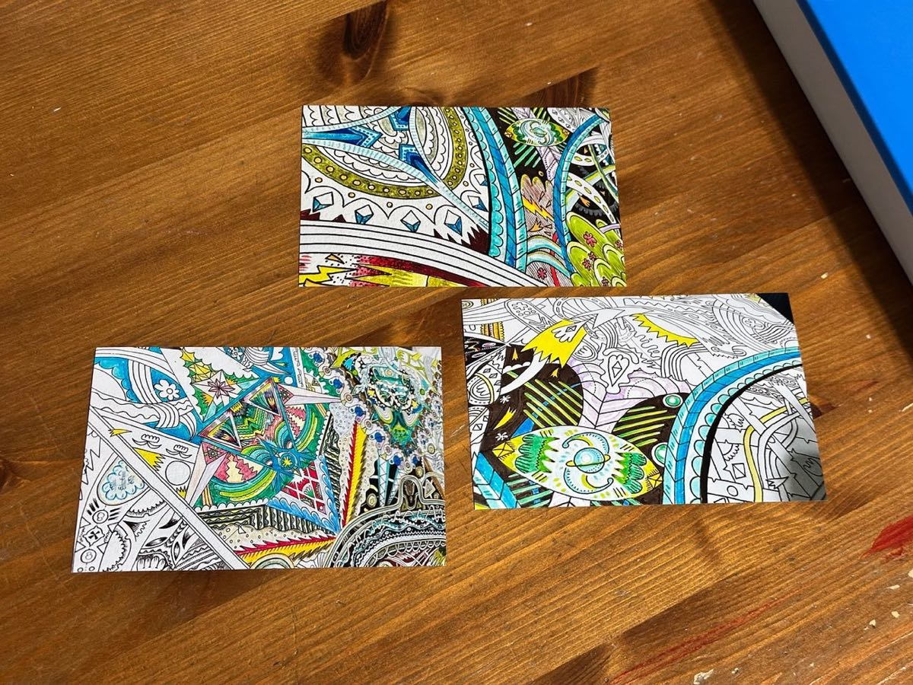
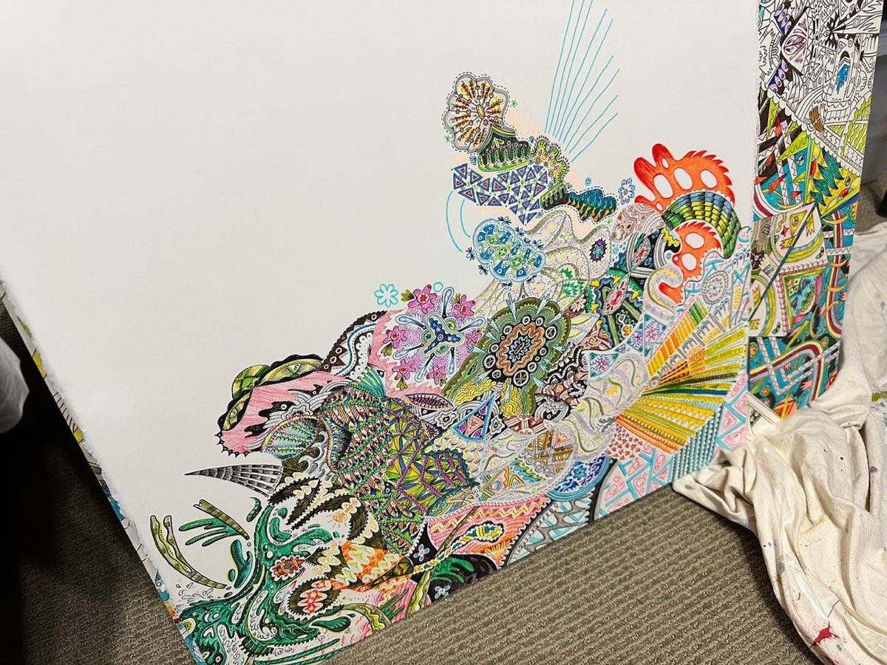
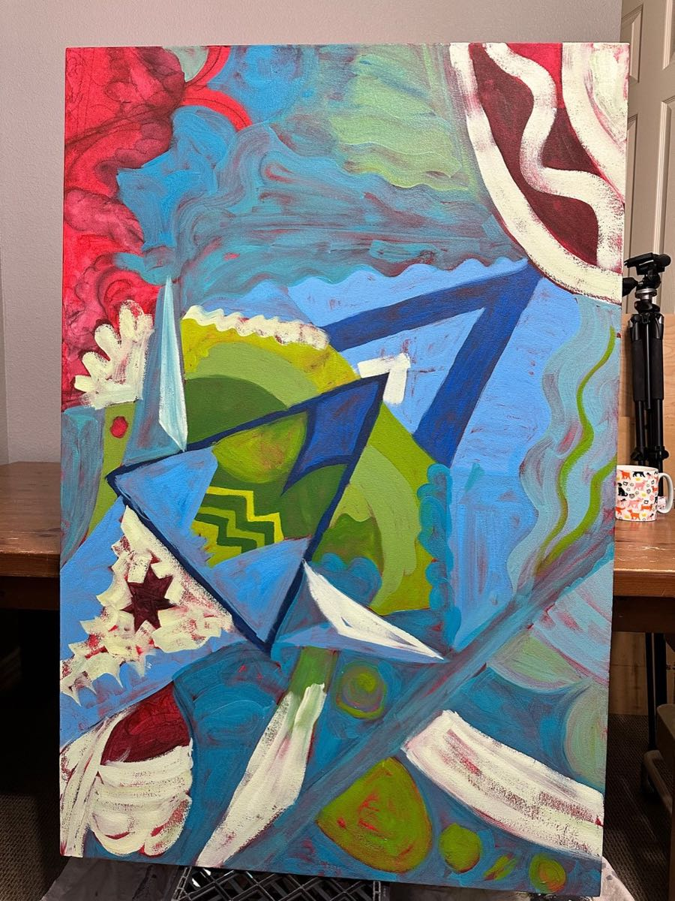
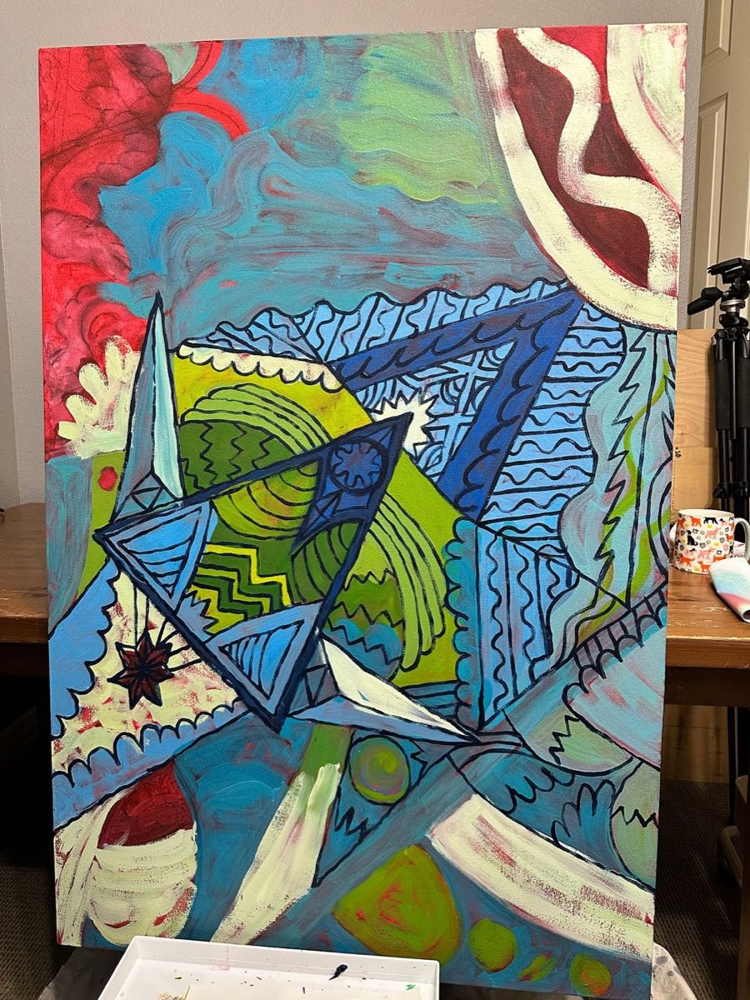
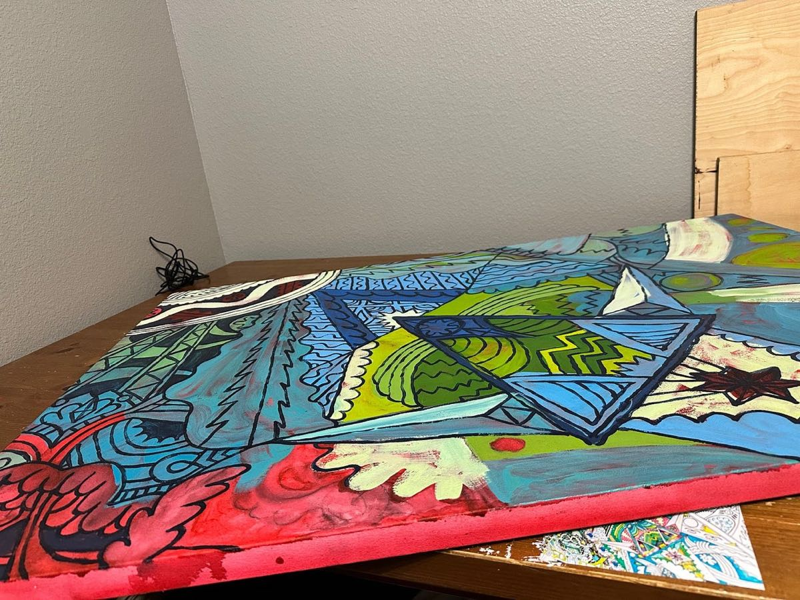
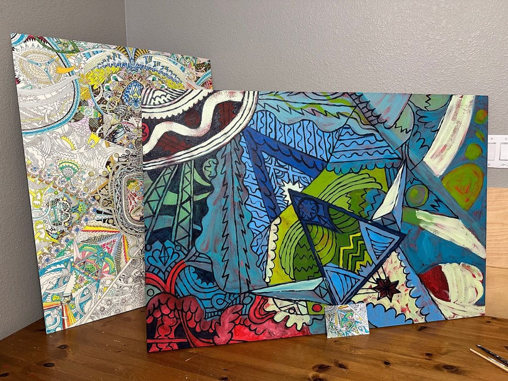
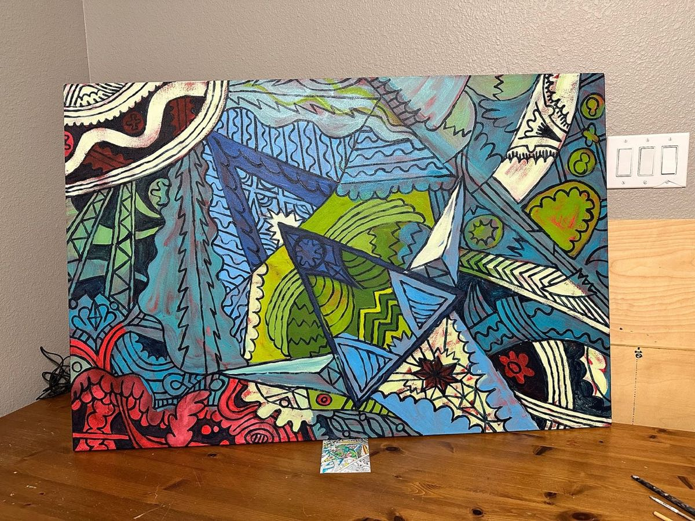

Now, I have 4 big canvases waiting.

## Reference

Decided it would be good to reference parts from an existing drawing. I didn’t want to overwhelm myself by overthinking the subject, but just make existing things come to life.

I took a few photos and printed them out:

<!-- more -->

Just looking at my old drawings, there’s loads of content to move to paint:

## Painting Process

Started by drawing the concept out with charcoal:

Then, layered on an underpainting in red. This mixes with the charcoal and produces some depth:

Roughed out some color overlays. Spilled coffee. Started to question if this was a good idea:

Added some lines to build it out. Then, it felt worthwhile and made more sense:

That’s where I have paused.

## Listening

### 1 - Storytelling

I have a “storytelling workshop” to lead next week and figuring out what to share. While painting, I have been listening to lots of videos on Storytelling.

What that turned into is binge watching David Perell’s “How I Write” channel. Never heard it before and have love it.

This interview with Mark Forsyth was fantastic.

This is like painting in a room with smart people talking about smart things.

[Watch the video on YouTube](https://www.youtube.com/watch?v=ulhrXgpjveA)

### 2 - I Am Rey

Found this creator’s channel on TikTok and decided to see if there was more on YouTube. If you can handle the way he talks, **the content is superb.**

[Watch the video on YouTube](https://www.youtube.com/watch?v=b6HnntxbbHs)
