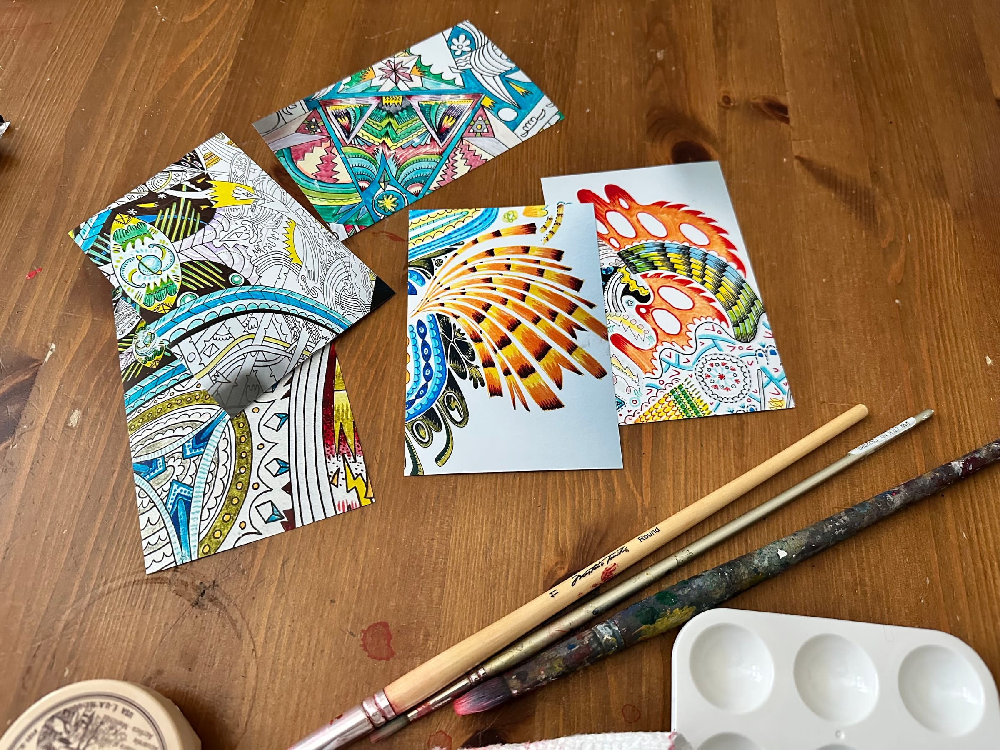
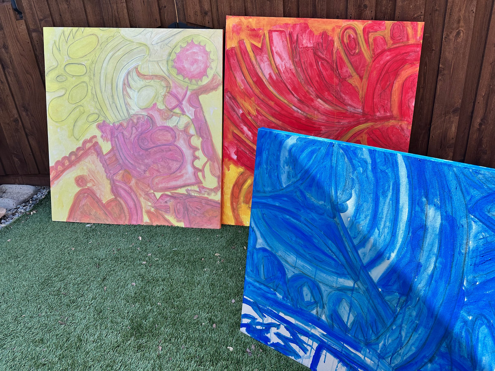
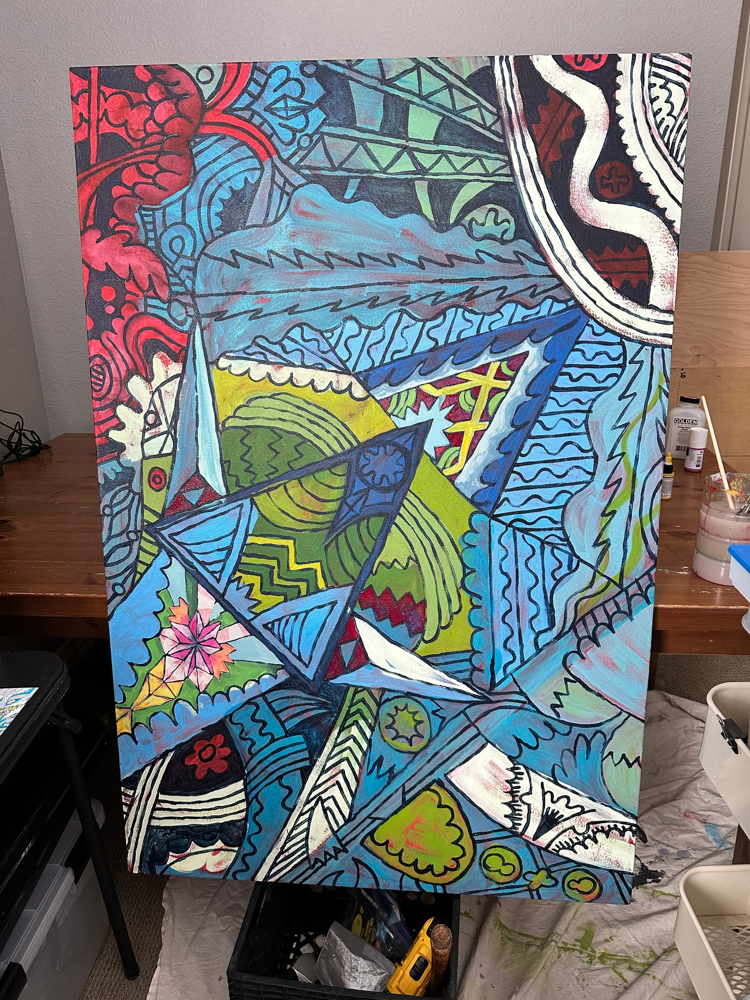
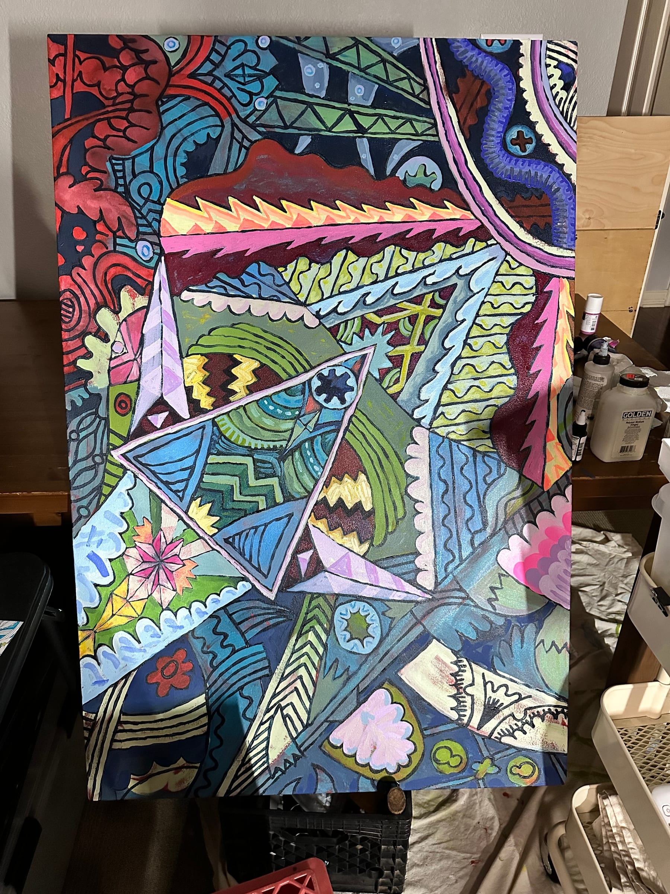

## Progress Update

Took some close-up photos of a bigger drawing. Printed 20 of these and worked with my daughter to select a few.

<!-- more -->

Over the weekend, used those images to set an initial drawing and underpainting on the other canvases.

Then, continuing to figure out the initial painting. (Takes a while… and I keep turning it to make it easier to reach areas.)

That’s about it. Again, just trying to share daily-ish updates. Aiming for 30 days. Hope this finds you well.

Paul
