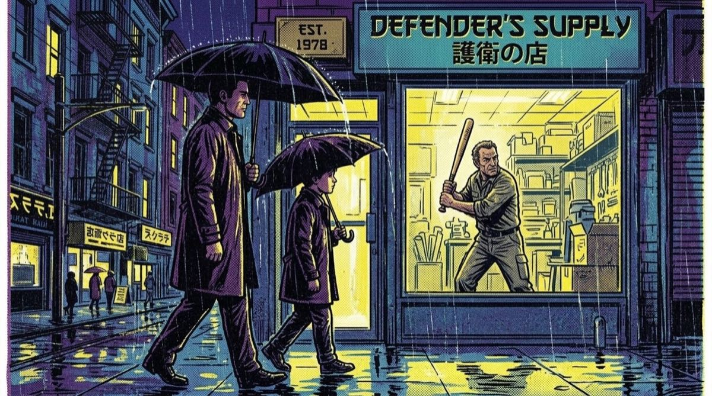
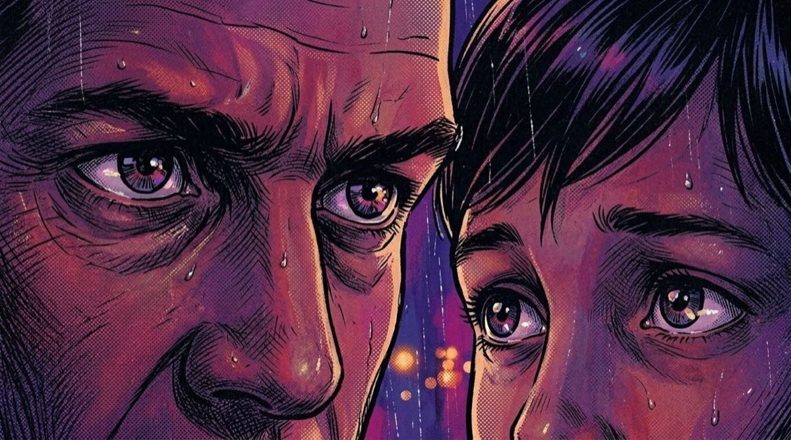
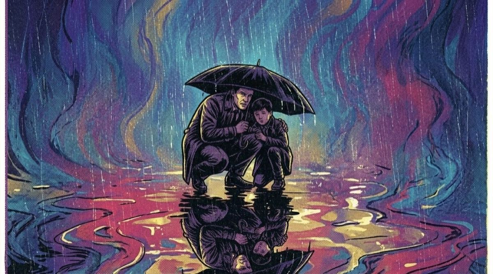
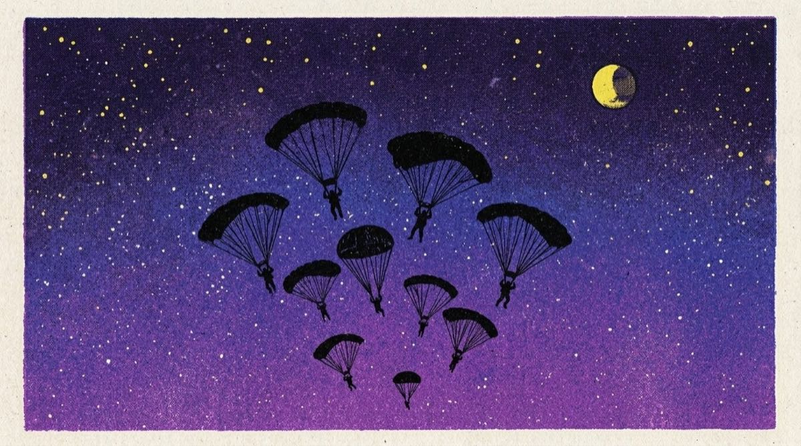
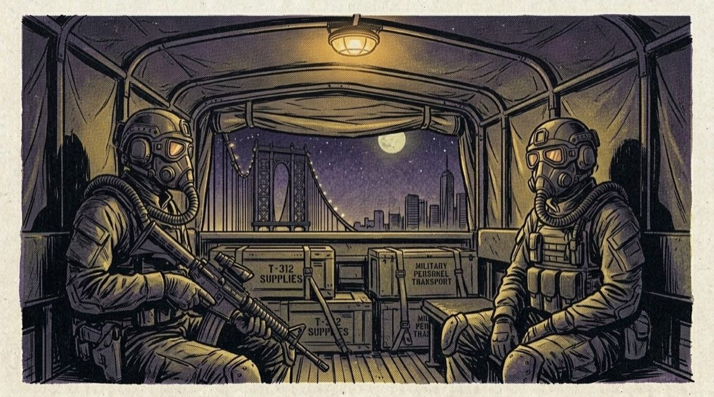
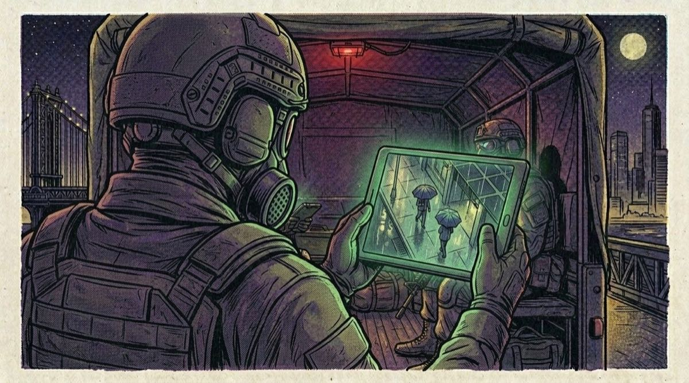
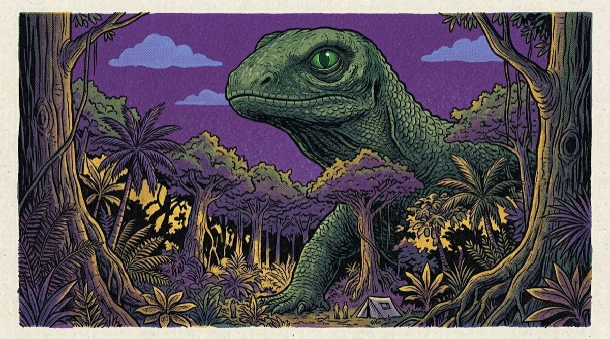
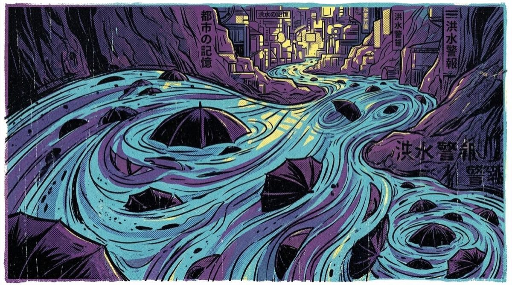
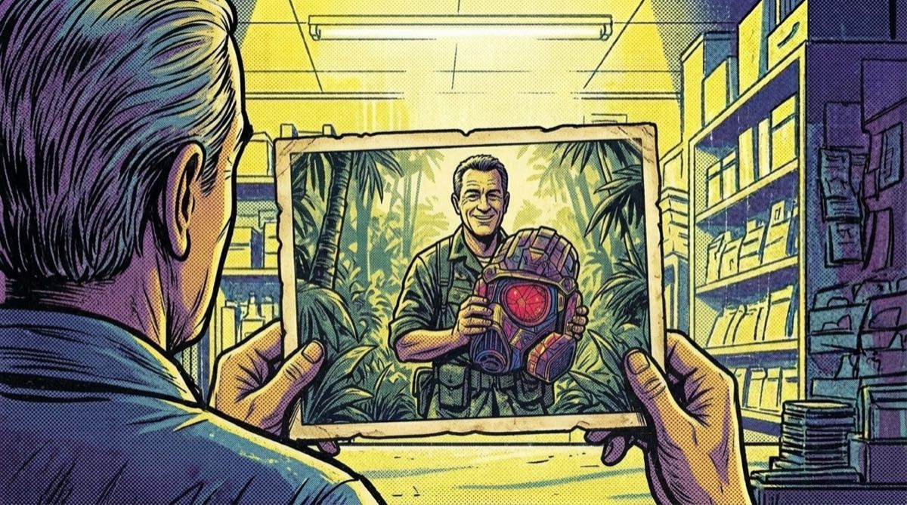
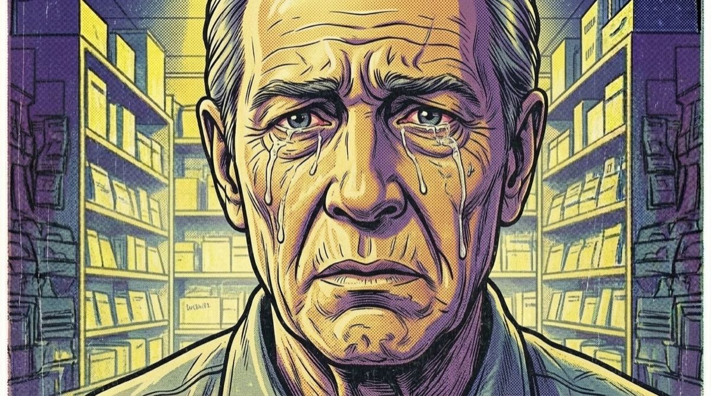

[Watch the video on YouTube](https://www.youtube.com/watch?v=HCN8sGvEqgg)

Explored a few visual themes and making a long soundtrack. This was a lot of fun to create. Guess it is like one of those lo-fi study tracks, except… a little more acidic. Still has that deep focus drone feel.

Obviously, I was generating the image and video segments. Then sequenced everything, making some kaleidoscope overlays. It still have a bit of craft to it.

The wild thing was playing with the potential storyline that was forming.

<!-- more -->

Be well.
