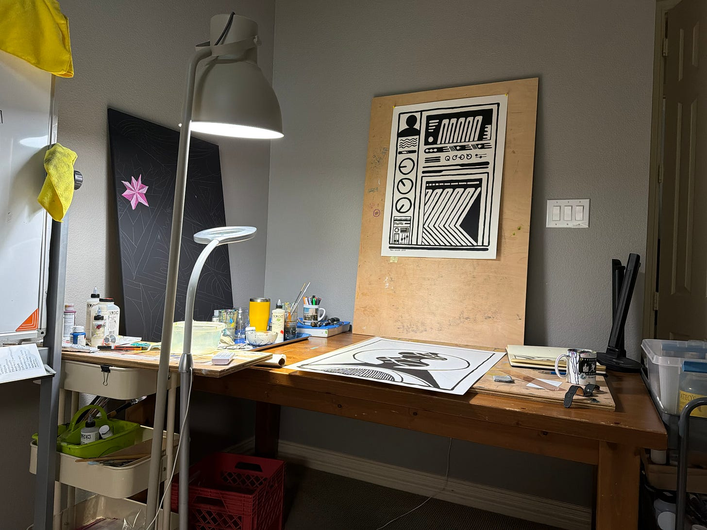

It was the morning of Saturday. I had rolled out of bed after some intense dreams that are now halfway forgotten. (They come back when necessary.)

The dogs were fed and convinced me to walk them. To do this, they send the small cute one. He sorta looks at me them moves towards the door with any glance to step that I make.

I set up the office in a more orderly fashion, after getting some poor reviews from my spouse. Not only the orderliness of the space but my persistence of being loud of work calls in the kitchen when we’re both working from home. It is preferred that I go back to my cave.

The computer desk had become a painting desk. The iMac and 28 cords of whatever where now pushed to the side.

In the attic, I wanted to bring the old IKEA desk down. Could not find the bag of screws that go with it. Instead, I opted for the old kitchen table, also from IKEA… but all the screws were bagged nearby.

Got my last remaining home-based kid to help me get the gigantic wooden table down the steps without killing myself or wrecking the house.

It took me over an hour to put it together and sweat everywhere. It got done and once again I have a computer and “making things” desk in the room.

I put the “making things” desk back in the attic every so often, just trying to rearrange the space. This should work for now.

