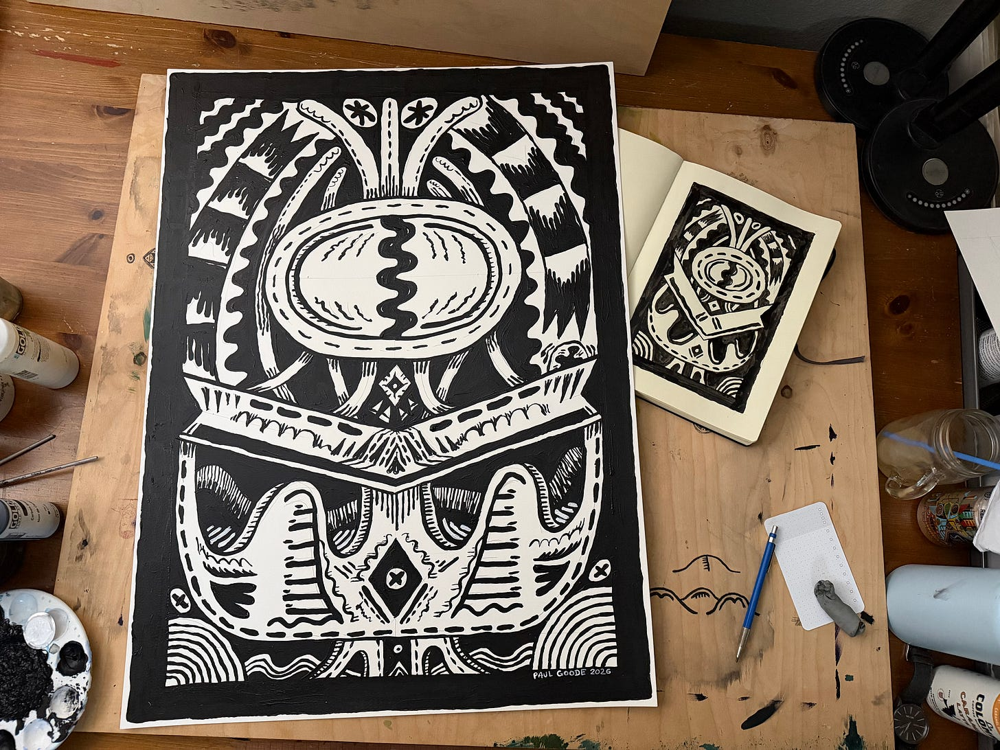
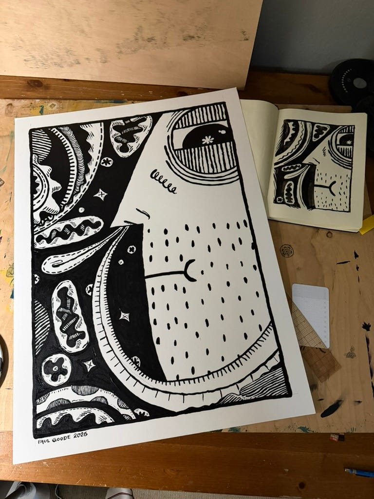
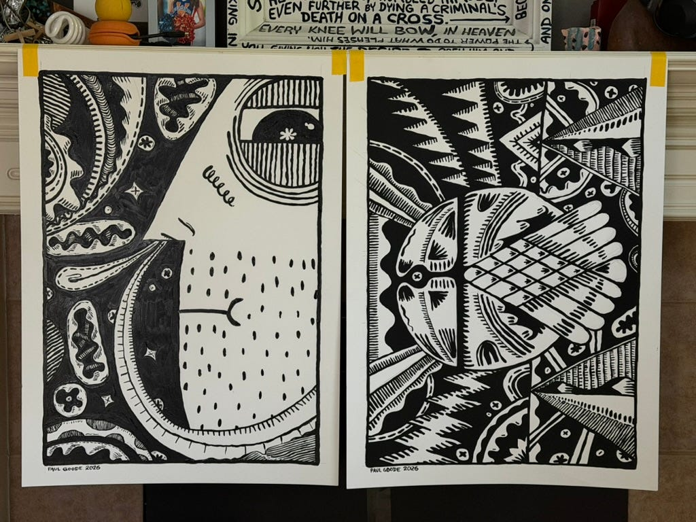
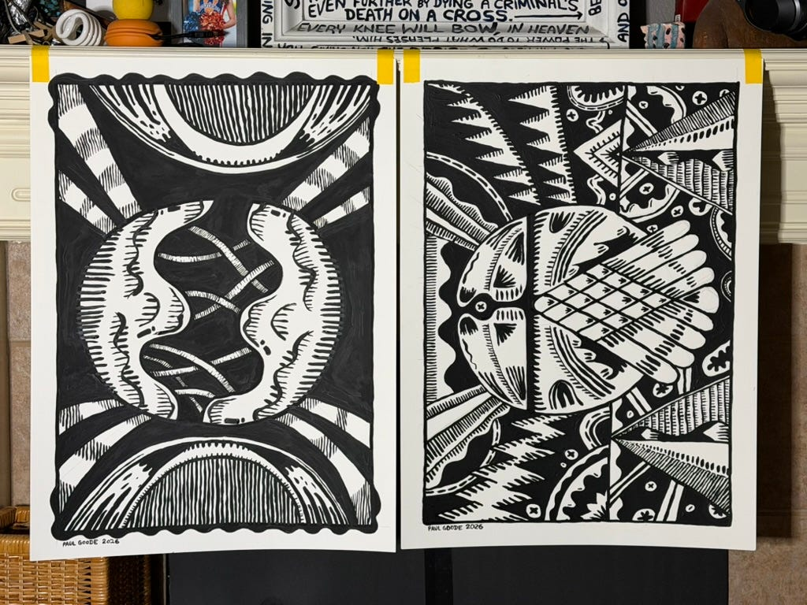

## Prelude

Hey, just trying to share things I’m working on.

I’ve spent SO MANY weekends “learning something new” and never making progress. I would sit there and TRY to learn After Effects or whatever and tell myself, “you’re going to need this”… but the truth is… I don’t.

What I need is to learn how to get my own voice out… to learn about what I’m making, have dialogue with it, and discern what it actually means. (Make my own meaning out of what I’m making.)

Fact is… I’m the only person that can or will make progress to figure any of this out. There’s lots I want to do. For example, I have NEVER done a “color study”… or challenged myself to “make something explicit.”

Even the production of THUMBNAIL > SKETCH > BIGGER THING… is an absolute mystery to me. I tend to work out themes/ideas while in the medium. I prefer what is happening at the moment… because it is like “wireframing meaning”… where I’m able to play lo-fi and make progress.

This has been helpful to me.

I think we’re heading into a time where “learning” is going to evolve. So, it is best to learn how to learn again. (I’m not going too deep on writing at the moment. Just planting seeds and moving on.)

## Things made this weekend

I’m calling this a spork, but may as well call it a “what is it”… because I don’t know… yet.

Here it is in all of its propensity to be odd. I will have to spend more time to learn about what it likes and dislikes. Maybe I will figure out where it lives and what it eats. Maybe it even uses a spork to eat.

<!-- more -->

Oh… I was also able to make this other thing, er, dude.

This particular dude appears to be leveraging a farmer’s handkerchief… which is where one nostril is closed and air is force out of the open nostril. This results in, hopefully, snot being ejected from the skull of the individual… er… dude (in this case).

## Yesterday

I created this orb thing… and made a video… but didn’t send it out by email. You can view it here:

[Building the Orb](/blog/building-the-orb/)

### Comparisons

Here’s the **dude** compared to the other recently created thing: **ultra orb**.

Then, here’s the **orb** and **ultra orb** together.

## In closing

That’s about it.

I’ve been able to get 8-to-12 hours of creativity time this weekend.

At this point, I’m getting pulled into the evening things:
- eat dinner
- feed dogs
- go to gym
- walk dogs
- sleep

My hope is that this is annoying enough… to get you motivated to do the creative things you’re called to do.

**Later.**
