## Previously…

Last you heard from me, I went all in trying out digital tools to generate sound and animations. I wanted to learn what it was like to “prompt” my way along. It was… not pleasing.

## Now…

I have all these little thumbnail sketches. Thought it might be fun to make them bigger and see what details happen to appear.

I made something with my hands.

I feel “on mission.”

I can seek to understand themes and move the work along.

I feel responsible.

**This is the better way.**

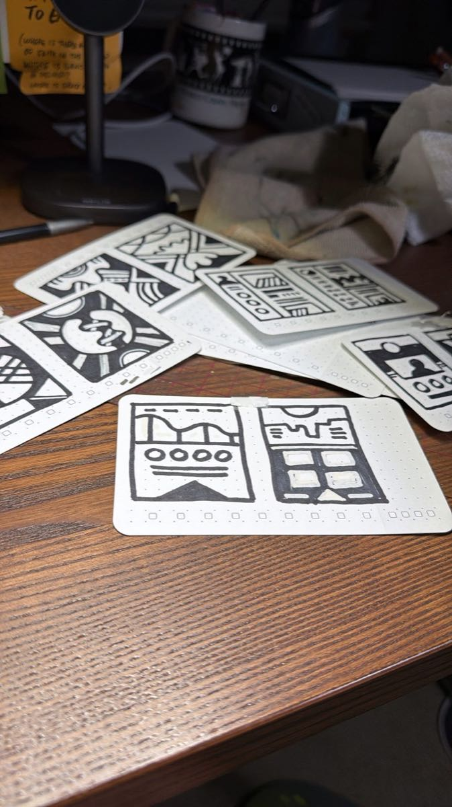

<!-- more -->

Here are the results, shown in pairs.

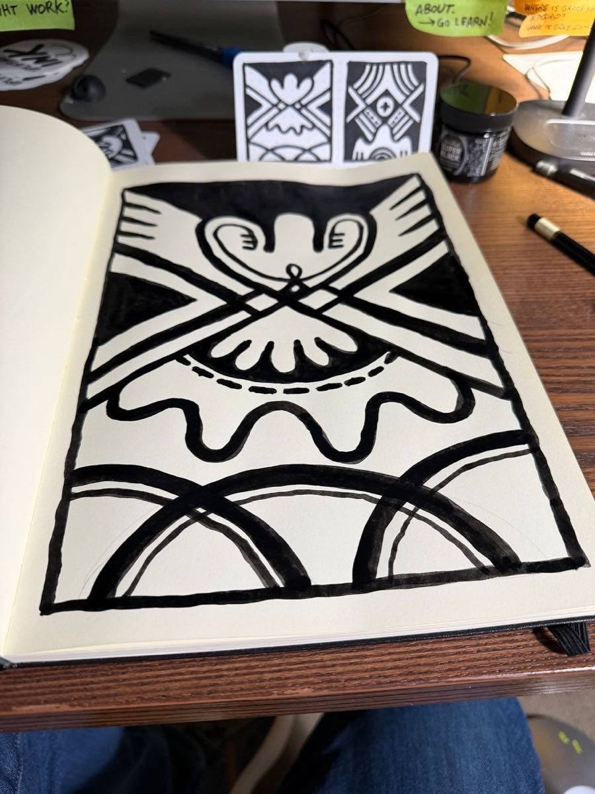

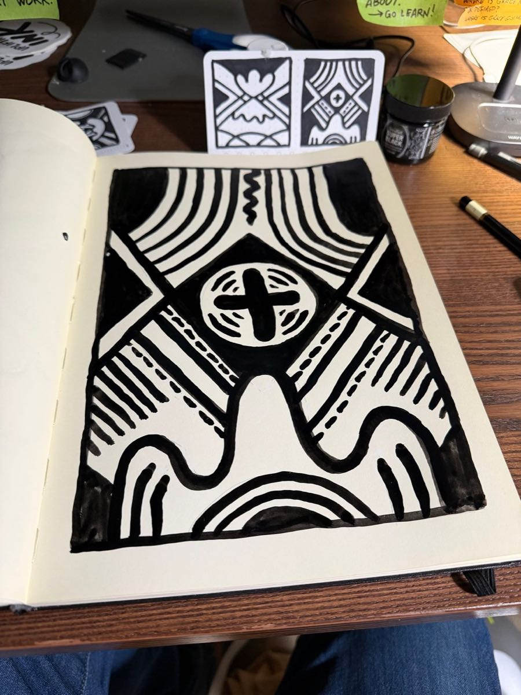

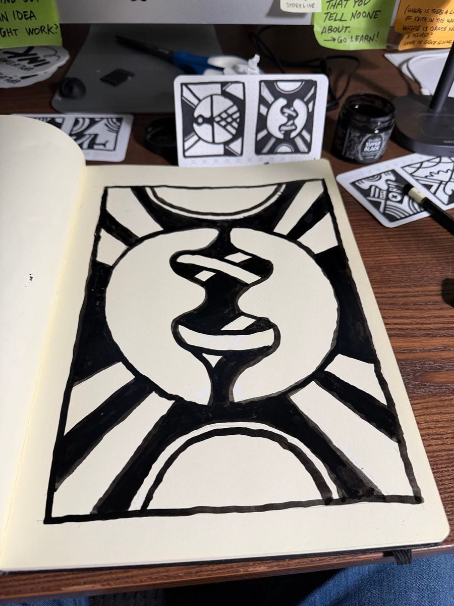

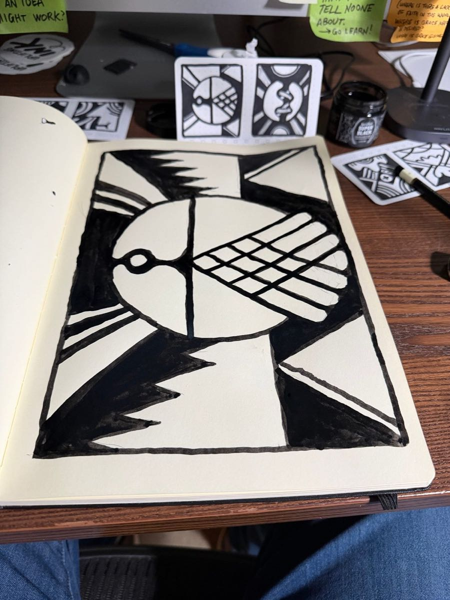

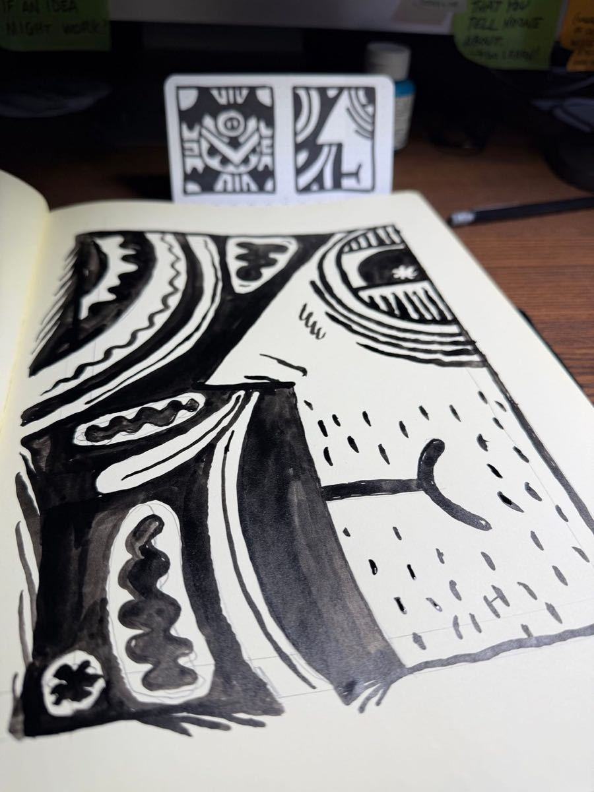

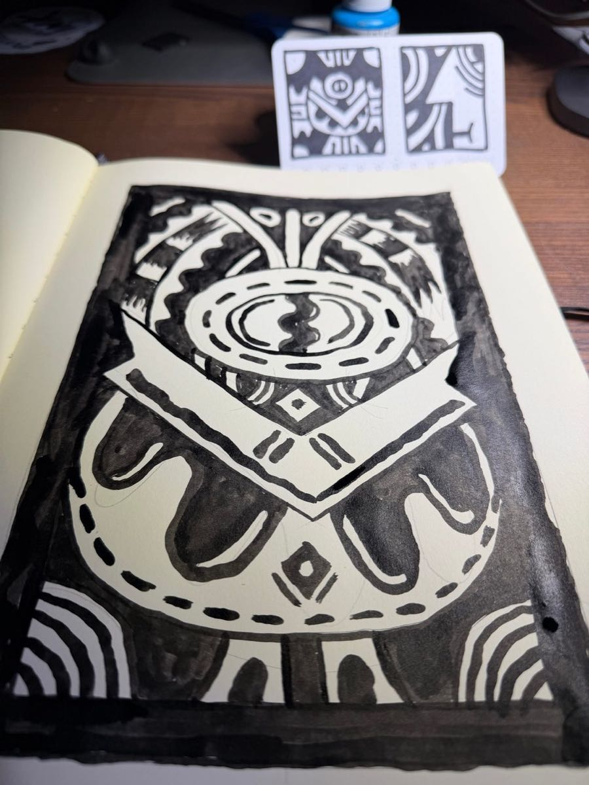

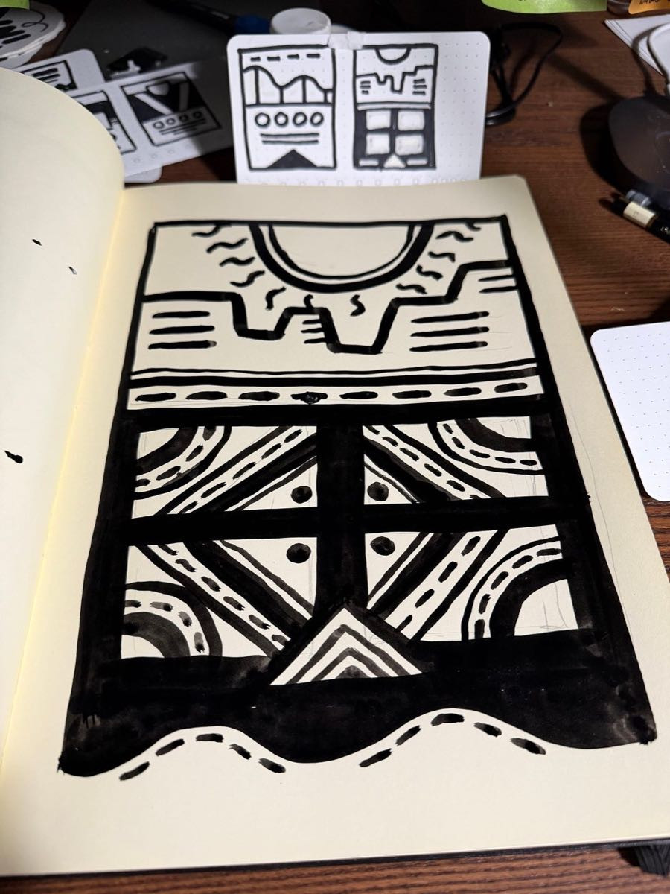

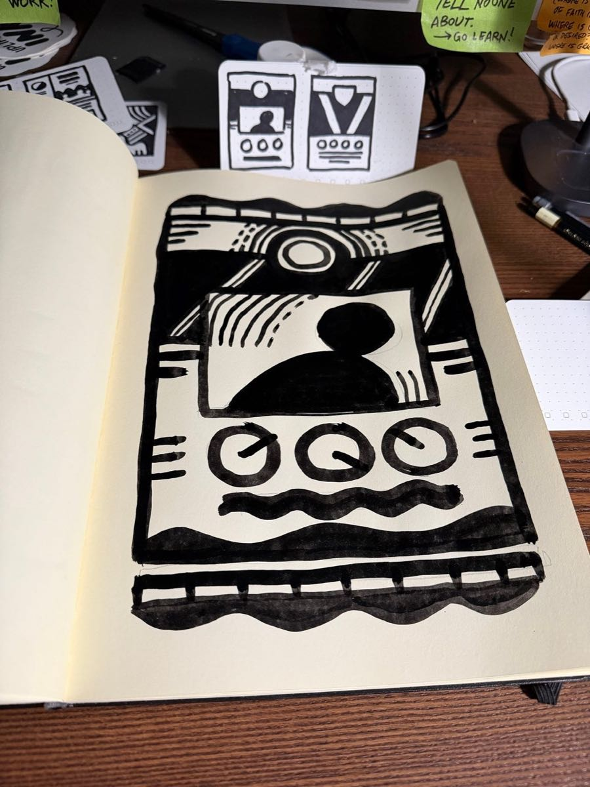

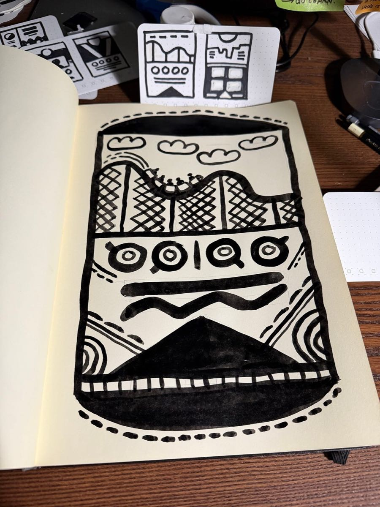

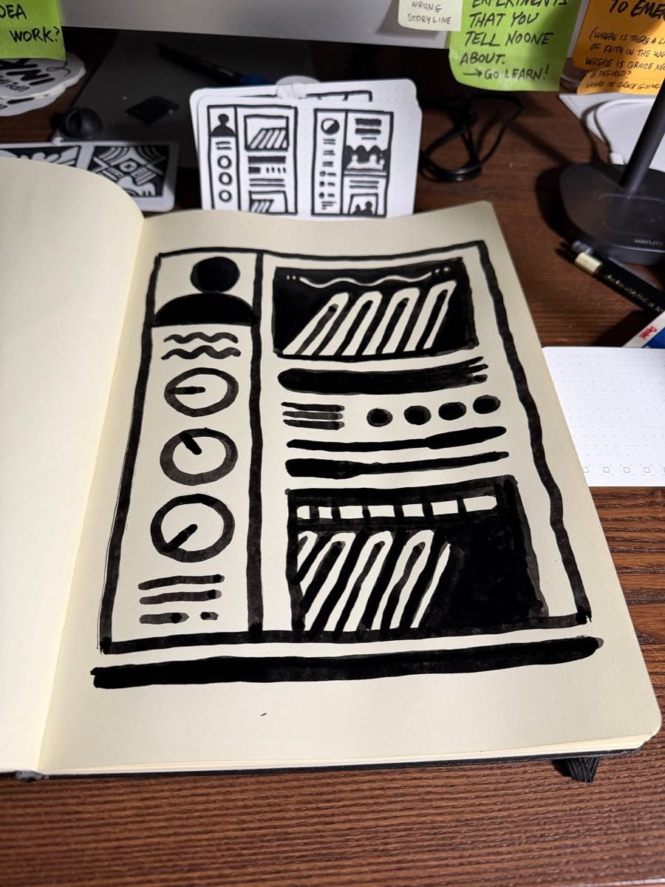

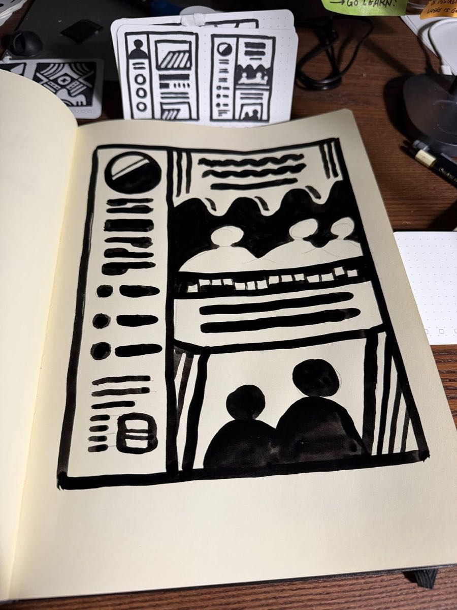

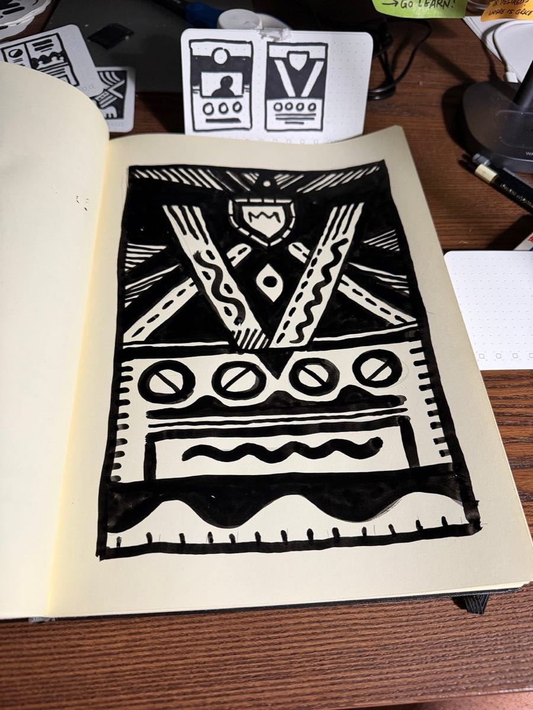
