## Painting Done

When I finally sign my name on a painting, that’s when it is definitely done.

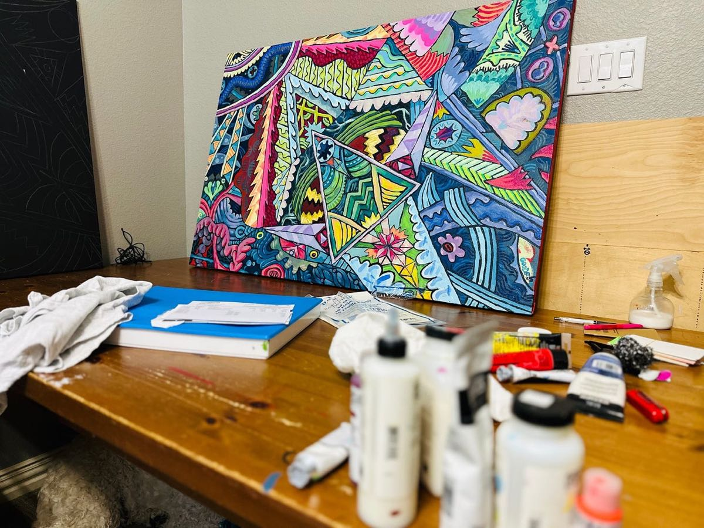

<!-- more -->

Getting something like this “done” in roughly 8 days feels amazing. Glad I kept going.

The work reminds me of a dream state. I see things like this when falling asleep or just waking up. It represents an in-between universe, like the a brain’s junk drawer of light and movement.

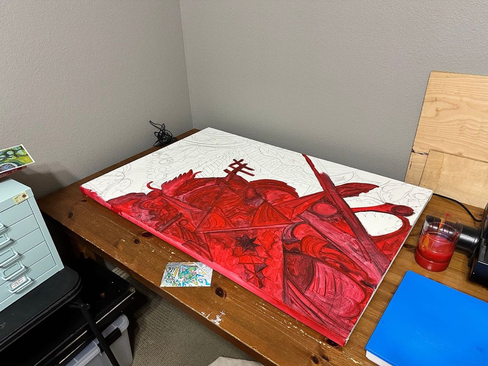

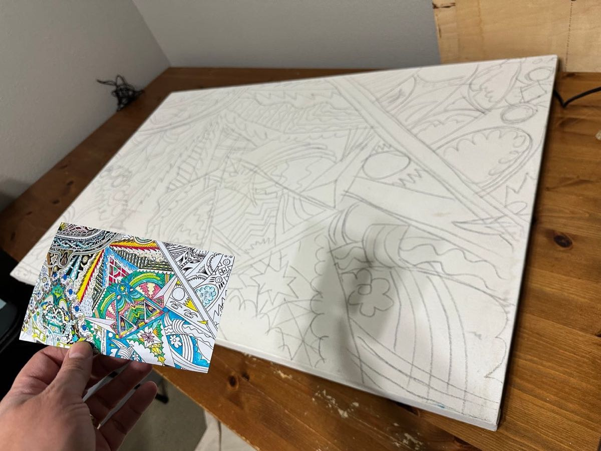

## Storytelling Workshop Done

Built a storytelling workshop and shared it this week at a local UX & Product networking group. The energy from everyone was great.

Ended up doing a lot of research on storytelling and writing. Focused on “clear thinking” and frameworks.

Here were some of the slides:

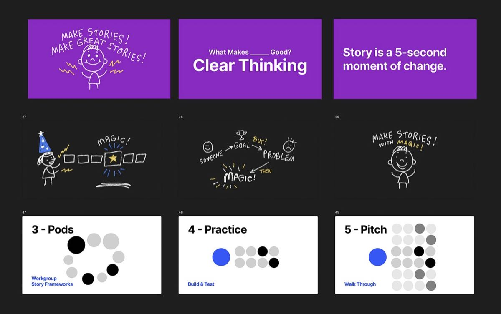

Then, just a glimpse at the prep and event:

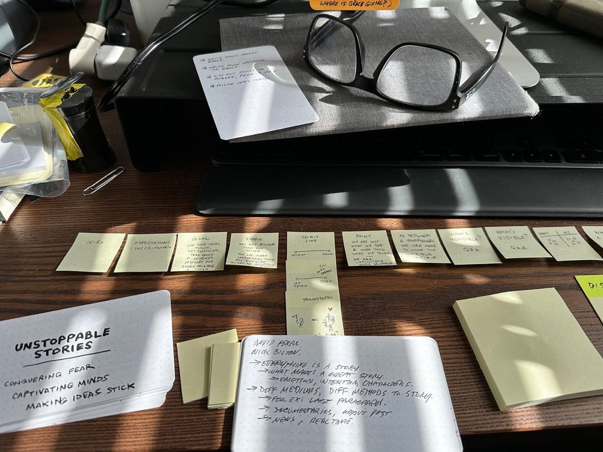

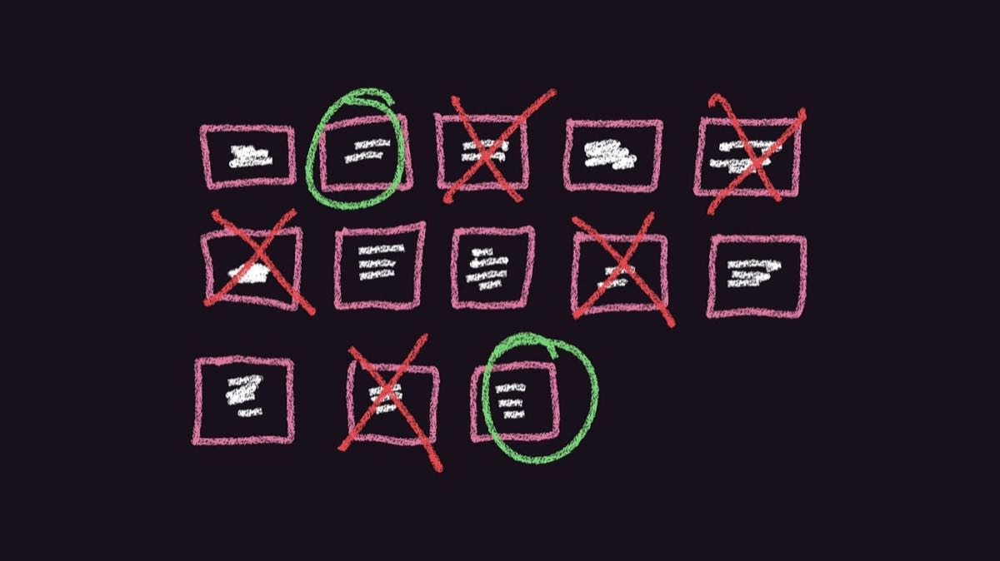

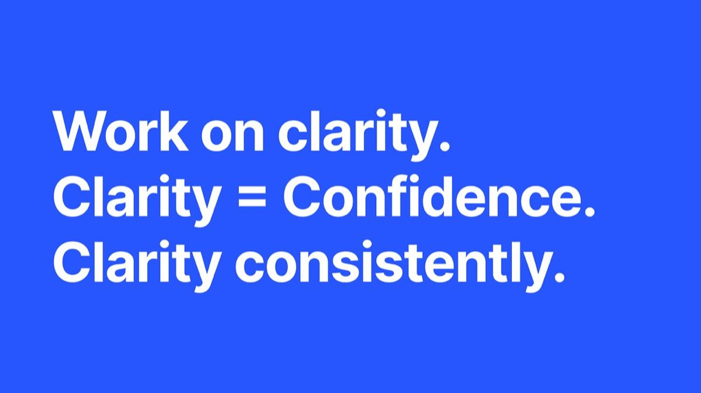

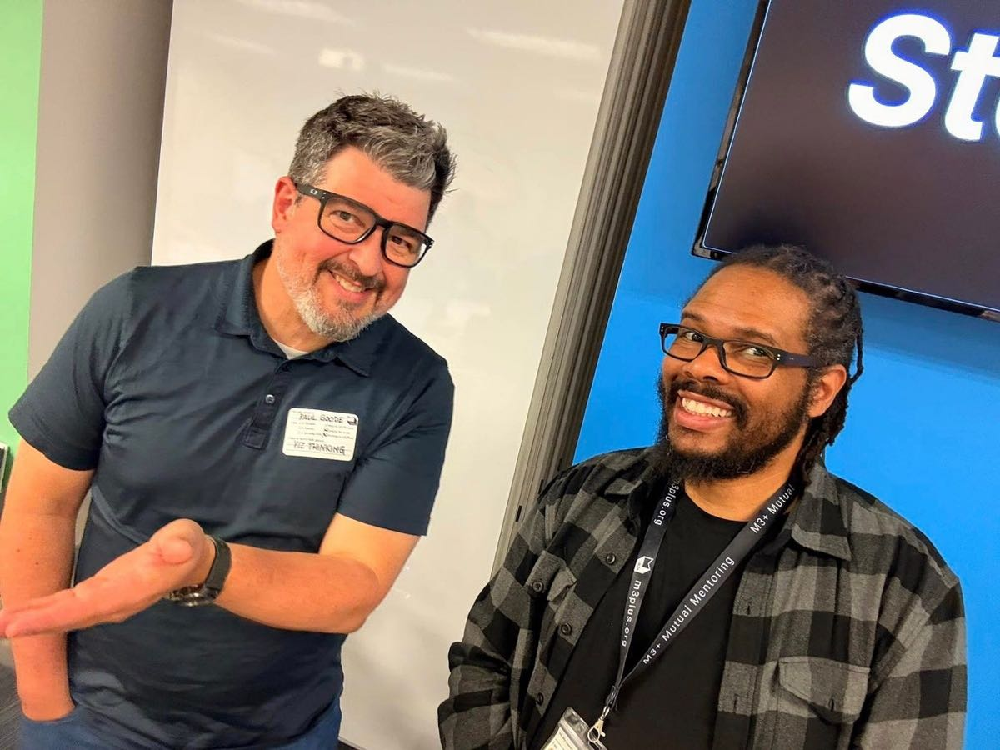

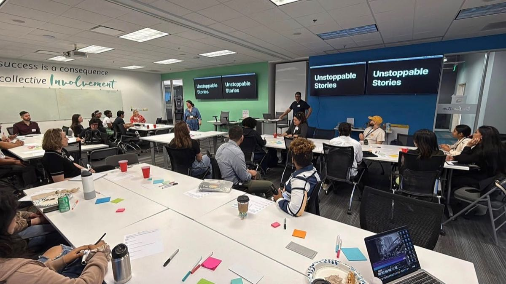

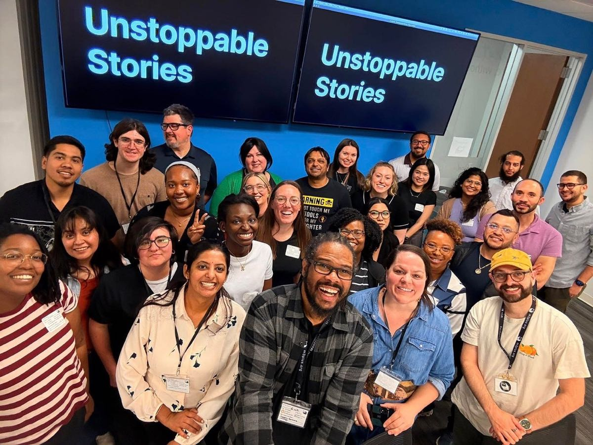

Pretty fun week overall.

There were some major ups and downs, which led to no updates, but I dragged myself through the mud to the finish line.

## Remember

Always “unsubscribe” from worry and fear. It will get you nowhere.

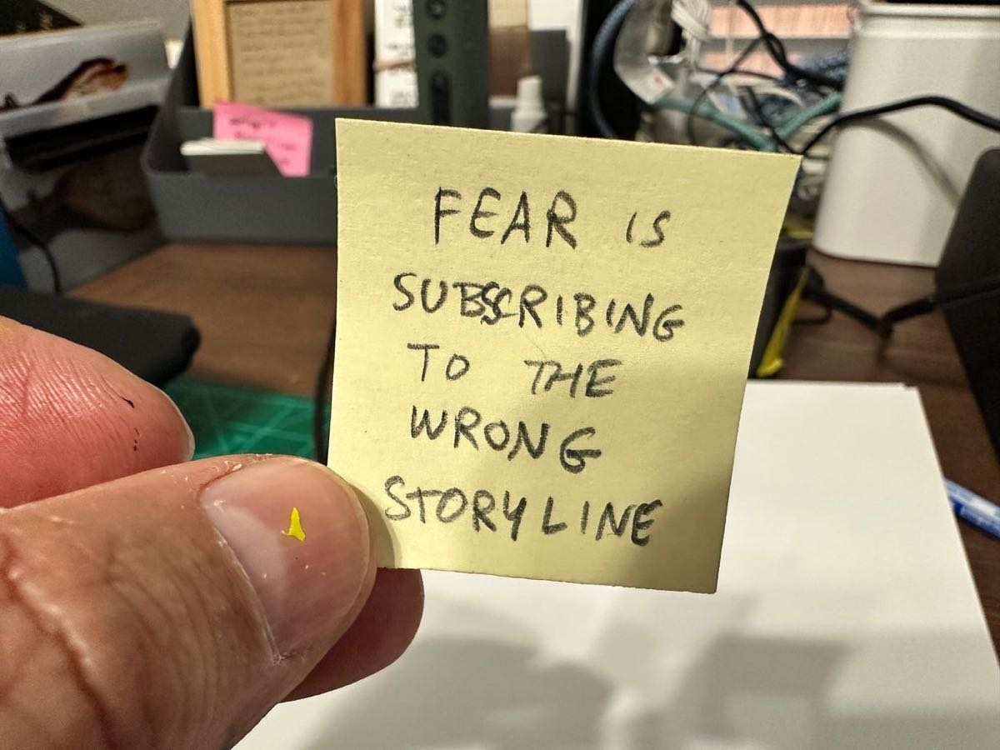

Thanks for everything.

You’re super valuable.

See you soon.

---
