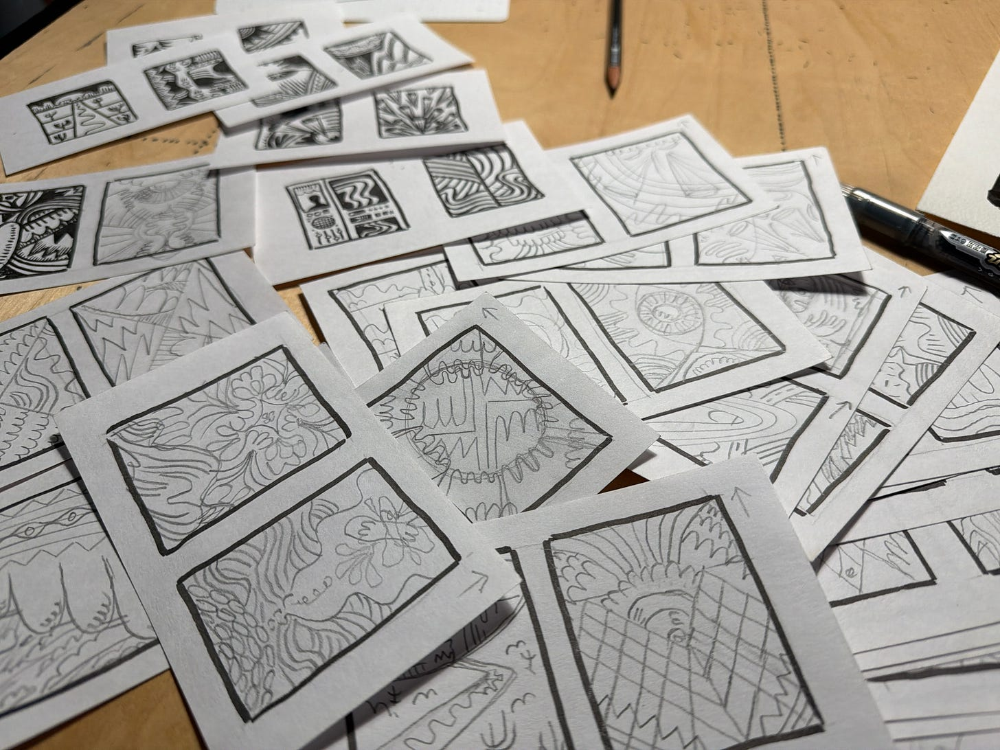
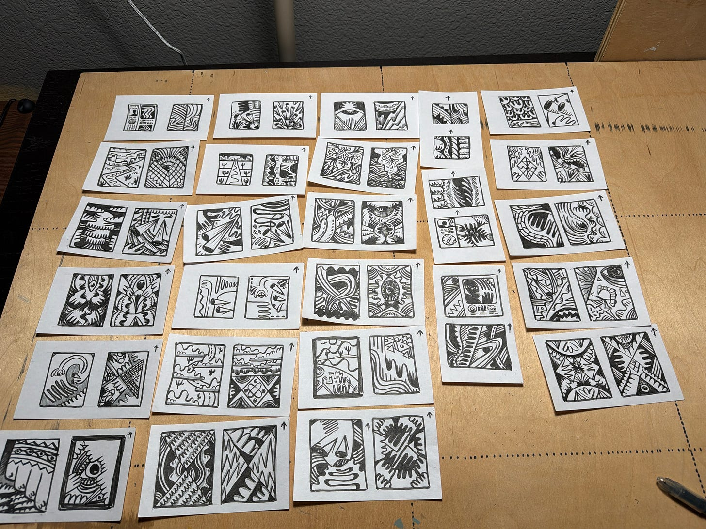
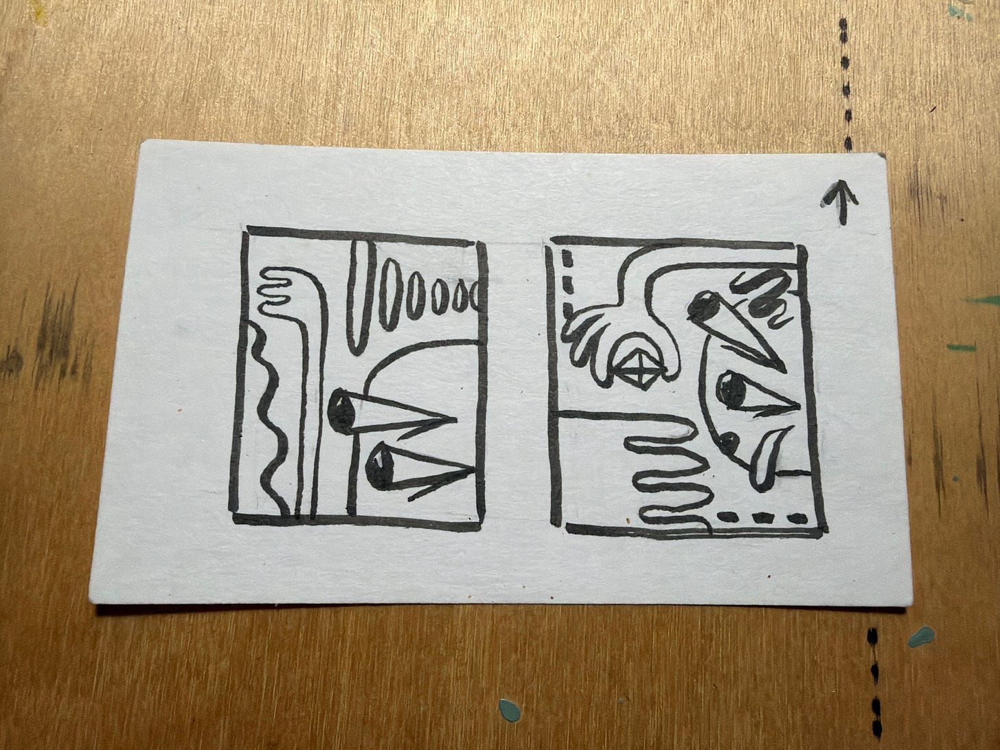
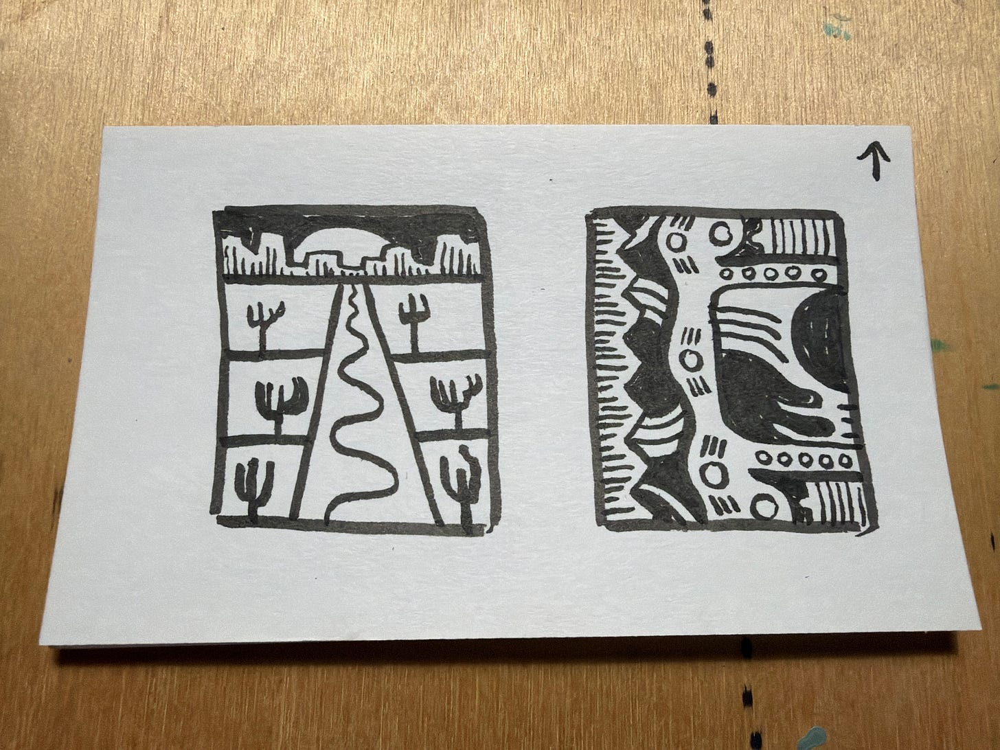
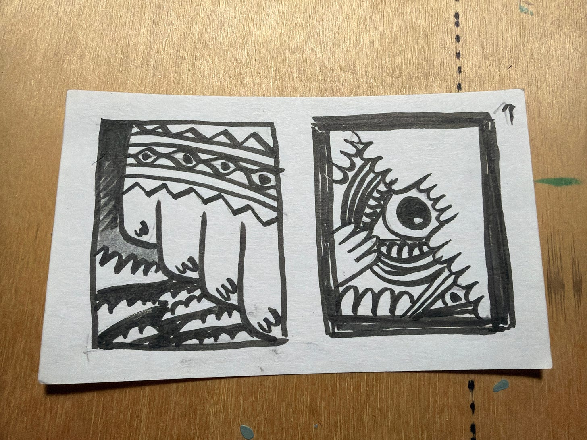
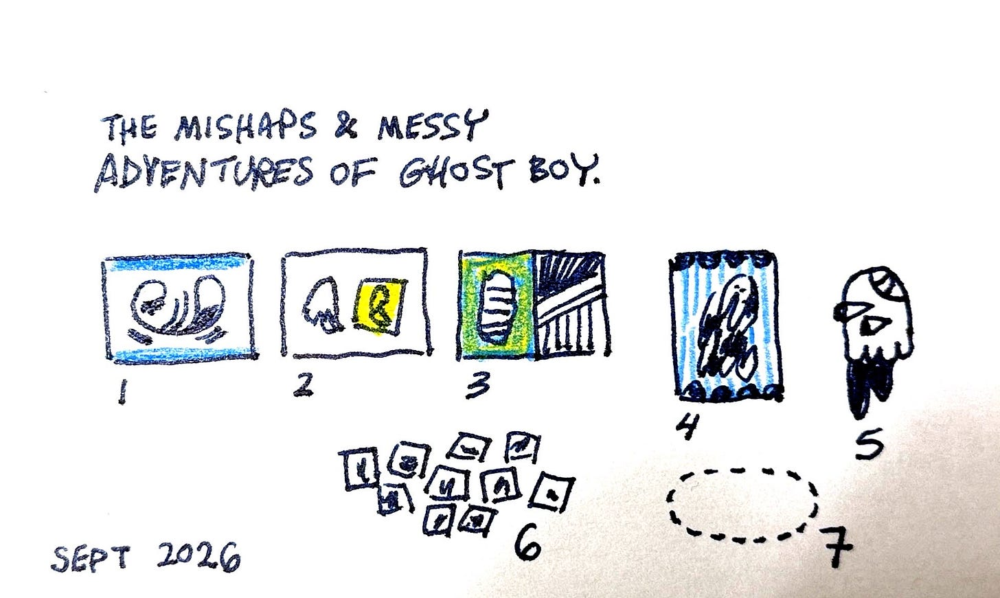

Spent the weekend drafting some thumbnails for my next series. Made 58 total ideas as thumbnails.

*I’m kinda rambling in here… but hope you find some encouragement.*

<!-- more -->

**Starting small feels right.** These are drafts. Maybe terrible… but as I make something a little larger, it gives me an assortment to pick from.

Feels awesome to have ideas ready to go. I don’t have to think because the “thinking” has been done.

Thinking is nice in spurts, but “thinking with my hands” is way better.

This task took the entire day.

I’m stoked.

This puts me ahead.

## What is “starting small” like for you?

Does “starting small” make sense to ideas you want bring to life?

What’s the small thing that you need to do NOW… that will make it easier to crank when you have time to work/focus?

What comes to mind for me…
- Kitchen Prep - you want to have all your portions ready, veggies sliced, so you can jump in and cook.
- Design - you want to have your colors and fonts ready, so you can just focus on layout and not get swamped with the pressure of decisions.

Starting small means… having some decisions already worked out.

Maybe quilting? You’ve cut all your squares, mapped it out, and now you find time to assemble the pattern.

## Back to the sketches. What are these things?

One thing you’ll see is “ghost boy” at the moment. He gets fascinated with shiny objects and forgets that he is only a ghost. As a ghost, he can’t take shiny objects home with him. He gets overwhelmed with life, forgetting that he is just ghost that here today and gone tomorrow.

Then, you’ll see some ideas related to the desert and driving. In my 20’s, I had the luxury of driving across the USA a lot. Driving into the desert was scary.

You had to make sure you had enough gas because you were going to be on a LONG road ahead. It was desolate. You were alone.

Then, as you’re driving along there would be billboards with attention-grabbing offers to see aliens or mummies at specific rest stops.

Your imagination would go wild. Out of mad curiosity you would pull into the rest stop, fuel up, and pay to see the creature they captured.

The creature would always be something completely ridiculous and you would realize that someone’s uncle slapped it together, put it in a glass box, and left it out back for suckers to pay and see.

I guess this series is called “The Mishaps & Messy Adventures of Ghost Boy” or something. If successful, there will be big things, small things, and wall sculptures/reliefs. I see color.

## Back to you. What should YOU do?

Maybe there’s something that **you’re called to do…** and you’re spinning in circles.

You keep “thinking” about doing it, but not ever finding any traction or results.

Figure out how you can start small.

Start “thinking with your hands” and take action.

If you’re called to help people… find someone that you would like to help and… help them. Or ask them questions. Learn if “what you want to do” would help them or be worthwhile. Start learning.

Maybe you’re thinking about your idea as a cake. That’s hard and daunting to consider. Make your thinking smaller… make a “slice” of your what you want to do. A slice would simply have all the tastes/flavors of the whole thing.

Make a slice.

Let’s say your dream is to have a big garden in your backyard, grow herbs, or something like that. How about you just grow ONE THING this week?

**Just do one thing.** **Make it small**. Then, go and chill.

Or do five small things. Then, get off your own back.

Enjoy yourself. Do easy stuff… but do do the thing. Prep work is still work.

I did the thing.

**I did 58 small things. They’re all terrible… and I’m terribly happy about it.**

---

By the way, I made a [shop](https://shop.paulgoode.com) with the previous series. They’re kind of big and IMHO would look nice in pairs.

I have no clue if the pricing makes sense or if anyone cares. Mostly doing it for myself… because pricing and putting my stuff out there is hard. (I’m doing the hard things.) If you have educated feedback, please do share.

**Visit** - **[shop.paulgoode.com](https://shop.paulgoode.com)**

– Paul
