Had to add a UV-protecting varnish the last of the paintings. Took them outside. Laid them all out on the pavement. Realized there were 10 in all.

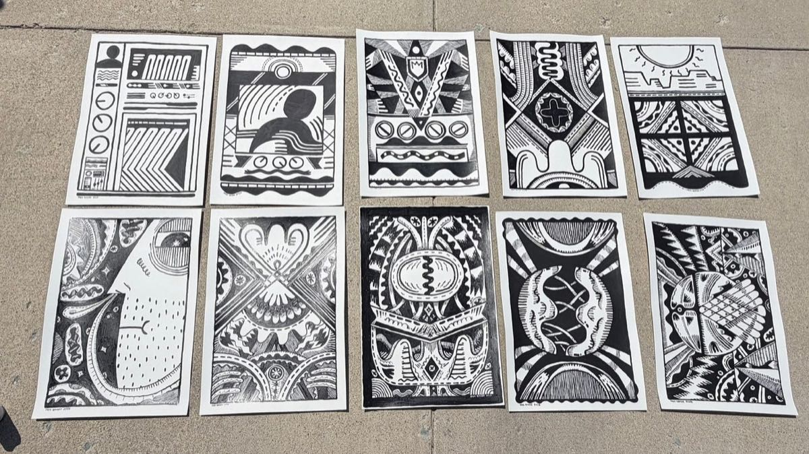

<!-- more -->

I make notes to myself. Cheering myself on. Breaking down thinking. Exposing the loops. Making 10 “of anything” has always been a big deal.

“Just make 10” would be the thing I would write down.

10 “of anything” would feel like a body of work.

Do 10 things and step back, look at it, make decisions… do it again.

Make 10.

---

## The Last 5

Here were the first 5.

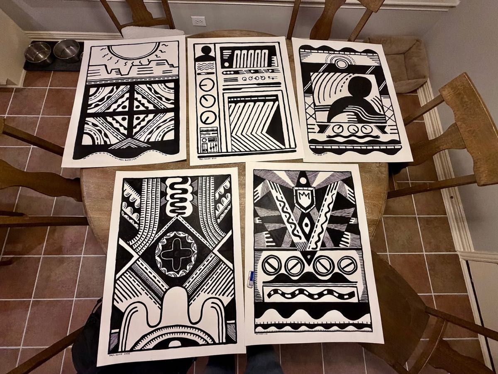

Then, I kept going.

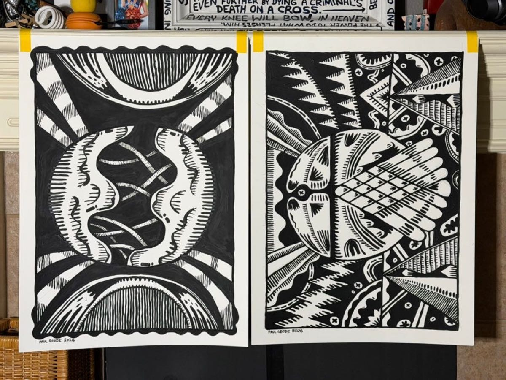

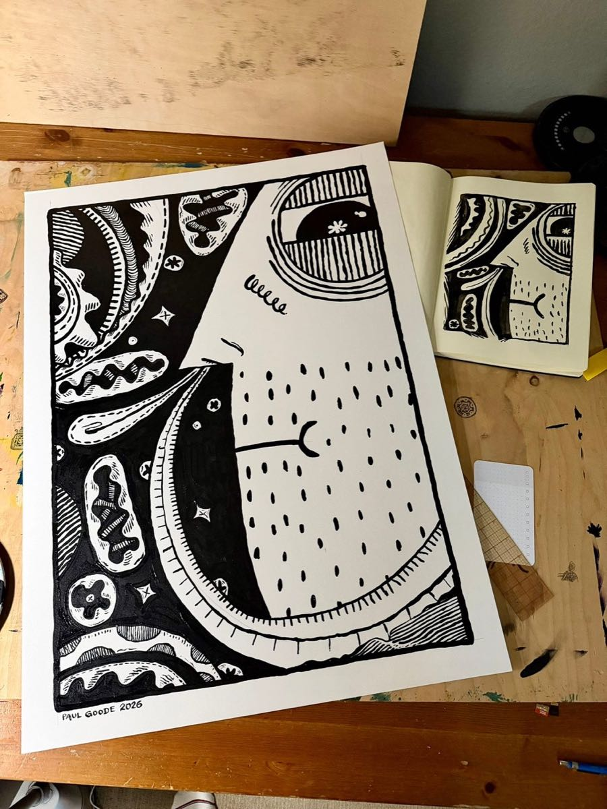

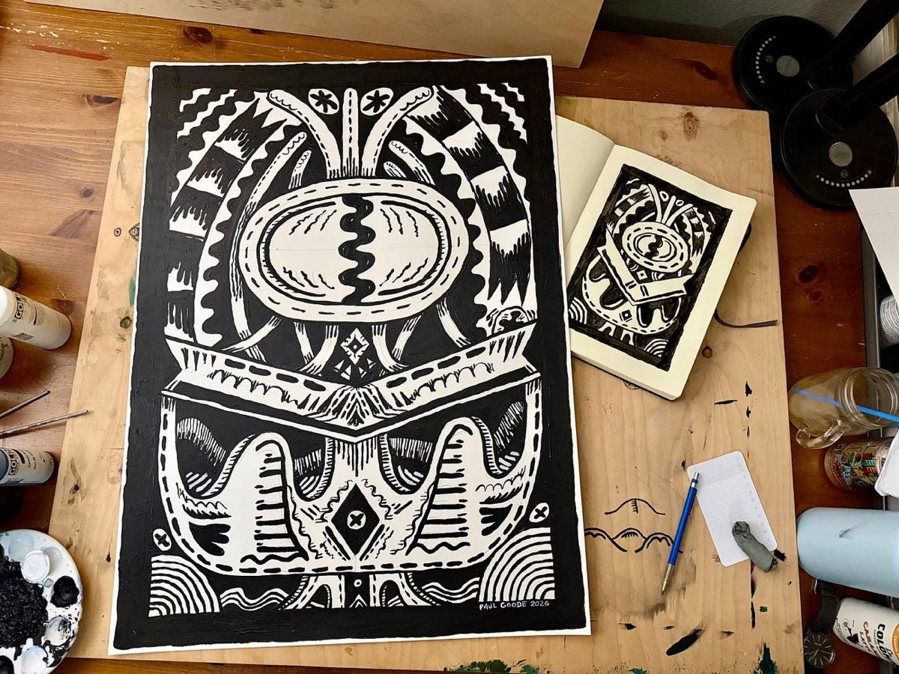

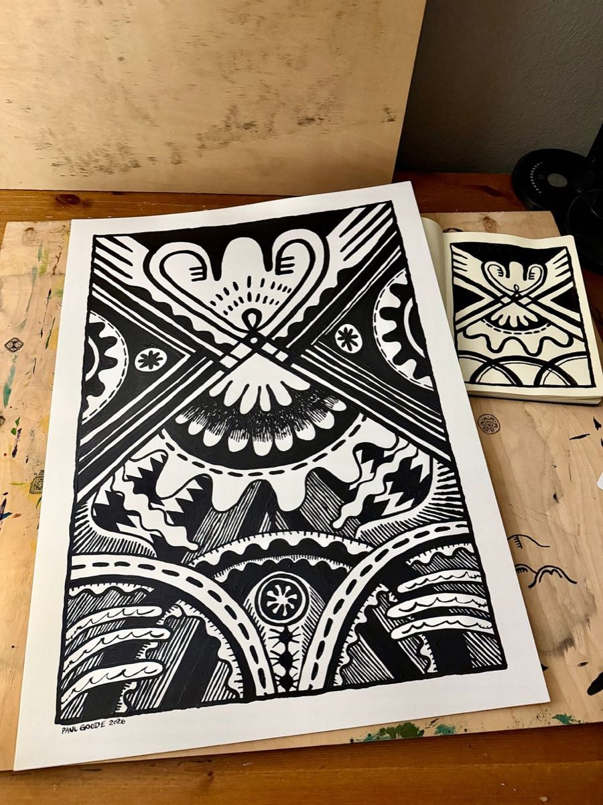

I made 10.

10 feels good.

I’m going to make another 10… of something.

Instead of starting big, I’m going to start small and grow.

## What is next?

I’ve been playing around. There are a few different directions that things can go.

Here’s where I’ve been poking around.

### Ghost Man

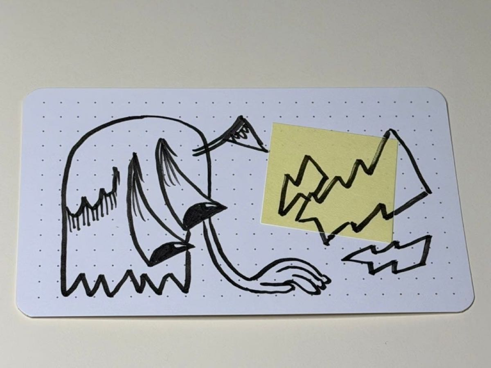

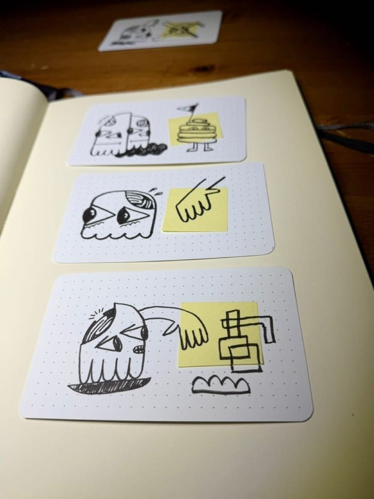

These are all a play on a few drawings from a LONG time ago. This thing has always been interesting to me. It is on a single card, but the combination is wild.

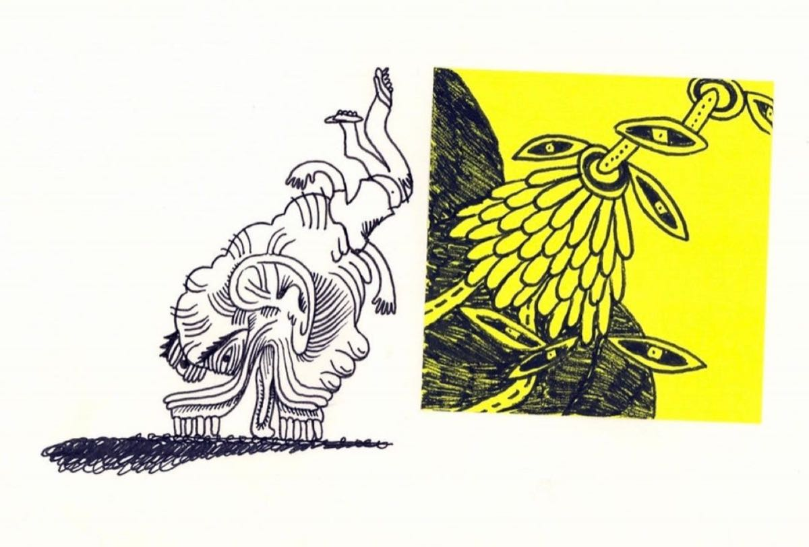

I’m often thinking about the heaviness of this fleshly life and the fact of leaving it all behind, looking back on it as it were a dream (after the death of the body). All of the body’s wants, needs, expectations, pains… gone.

Life is glorious, but the weight of glory is not in this dead weight.

We will leave and go beyond.

### More Exploration

These are possibilities too.

Here is Ghost Man walking creatures, dragging his guilt/shame/fear, his brain sputtering and exposed.

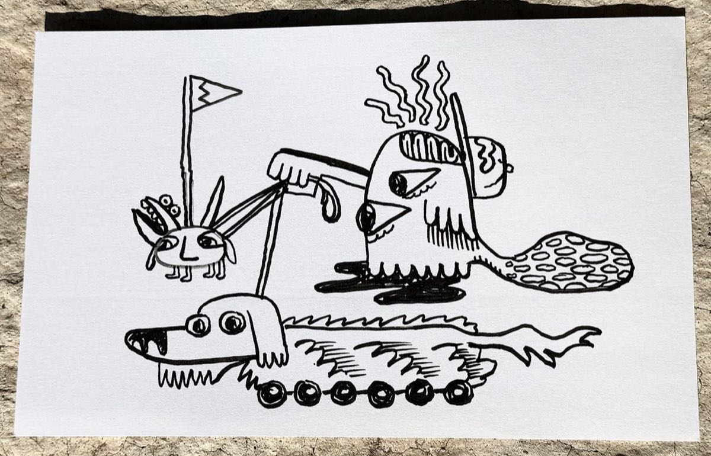

Ghost Man, fractured, caged inside contraption-after-contraption, breaking out of the machine (or is in the machine).

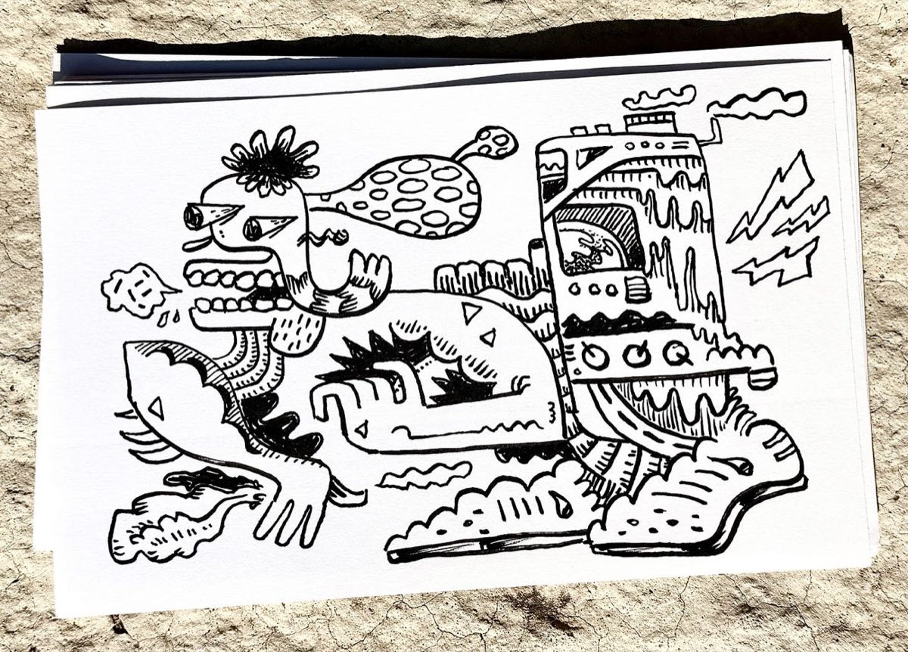

Now, Ghost Man is gracefully being dragged along by the teeth, grinding the cement, collapsing.

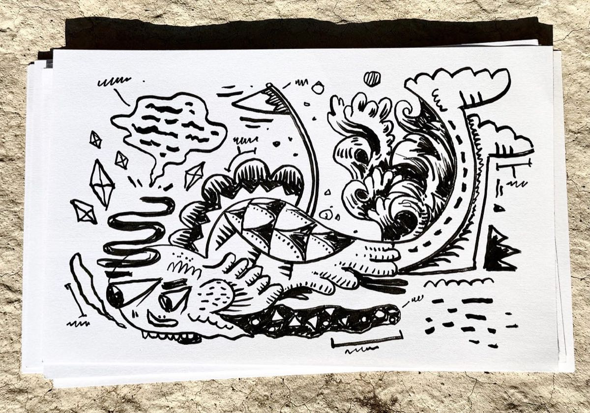

OK.

Back to it.
