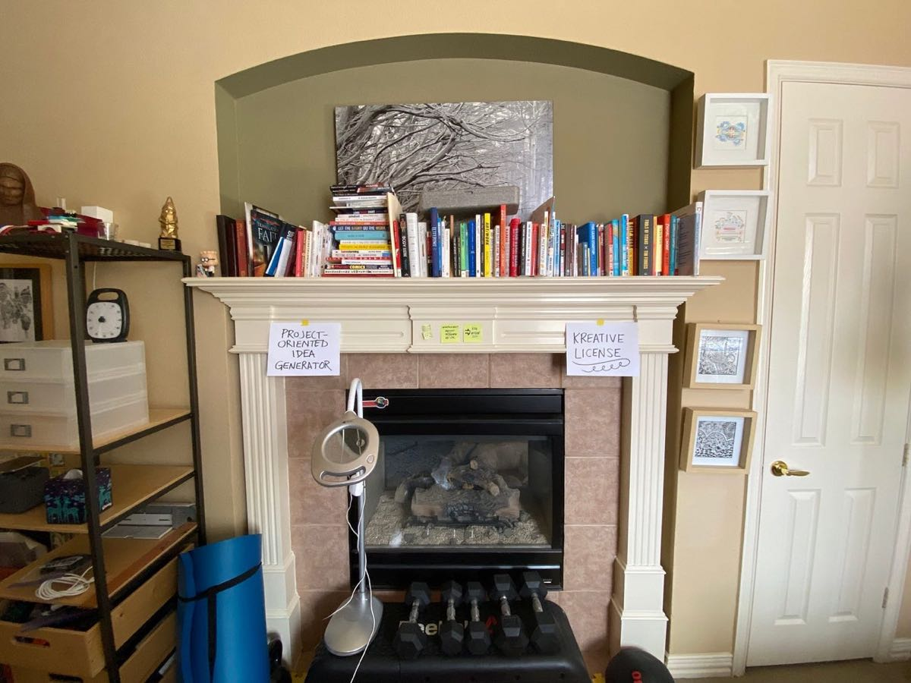
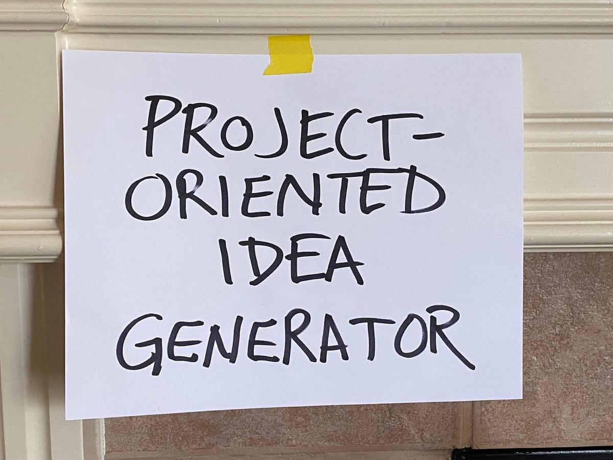
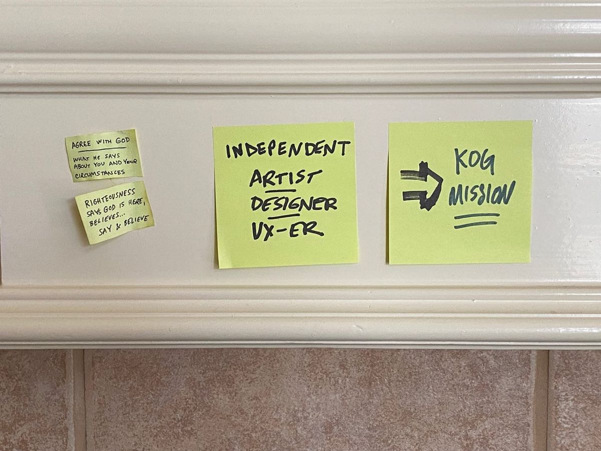
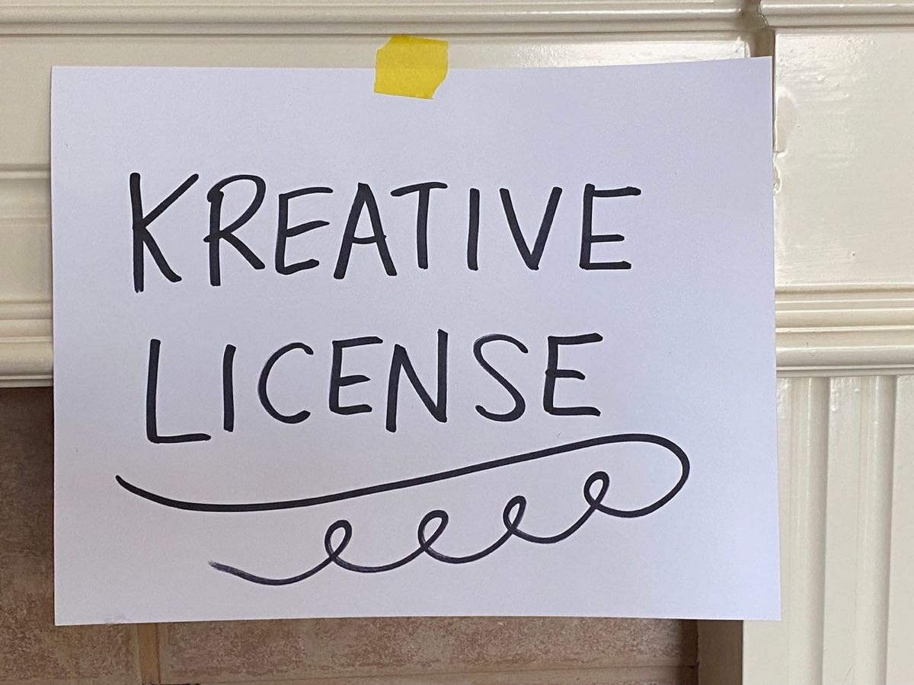
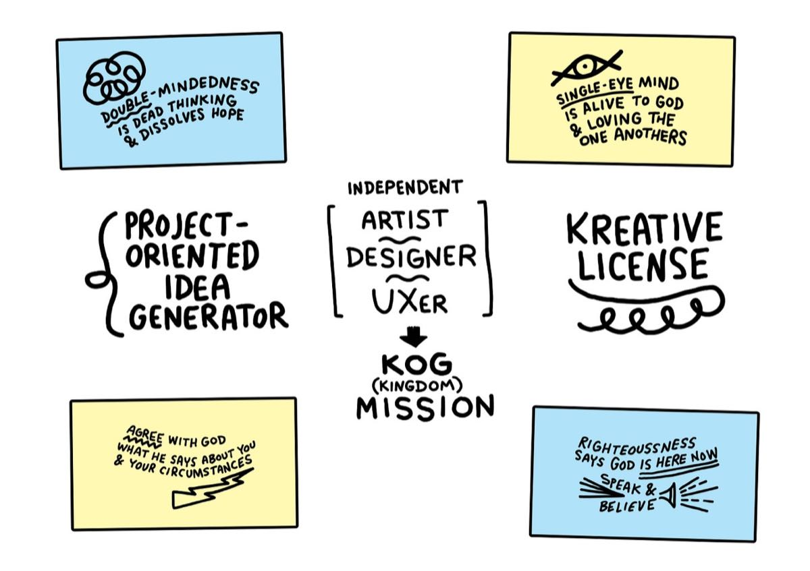
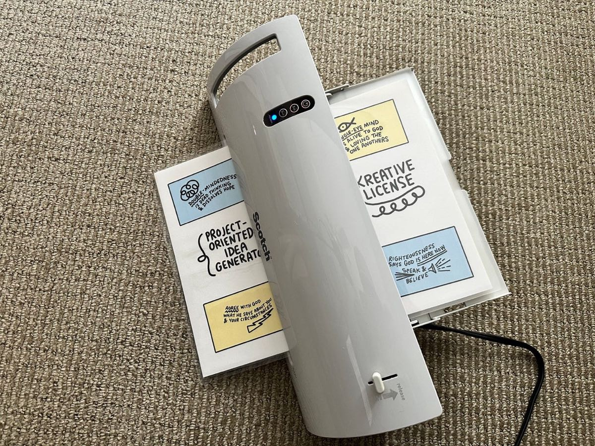
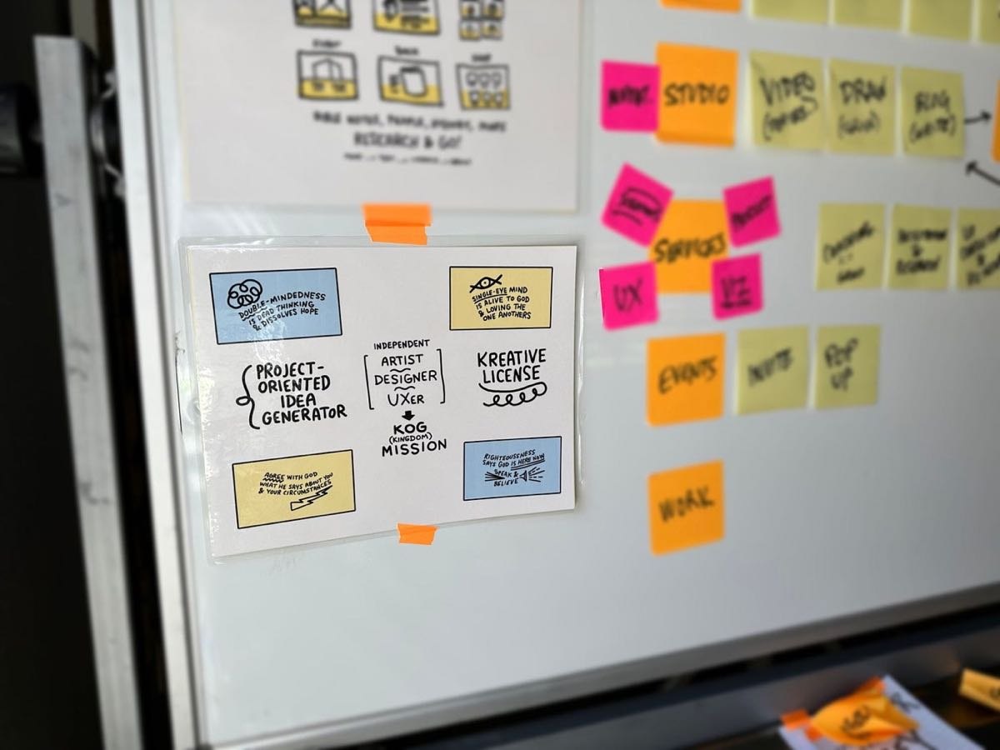

*Have you ever taken a quick break then realize you’ve been scrolling on your phone for 3 years? **Yeah, me too.** So, as I was saying…*

---

---

Like any modern spoiled brat that needs to recall memories, I looked at my phone photos archive to figure out what was going on in early 2022. (You know, that’s the last time I updated this sketchbook.)

What I found was a photo of these papers stuck up in my office. Let’s call them the "Triptych of Encouragement,” but each one of the notes is ruthless.

<!-- more -->

## #1 – Generator

This one is rough and says:
- Project-oriented idea generator

It assumes too much. Firstly, having a project assumes that I know what I’m doing. Picking up dog poop in the backyard could be the most “defined” project I put myself through.

Then, “Idea Generator”? This whole thing would be more realistic if it said, “Half-Backed Idea Abandoner.” **That’s reality.**

But, no, that’s not how we’re supposed to roll. In the Kingdom, we give ourselves a break and lean into hope. Not temporary hope, but hope that leaves a stain.

So, I wrote this and stuck it on the wall to challenge me.

It wags a finger at me and calls me to greater things. It says, “Focus, Bro. You got this, Bro.” but still leaves me in shock.

## #2 - Independent Mission

This one is a bit more cryptic. It is a collection of a few sticky notes.

## Little Notes

The first two say:
- Agree with God - What He says about you and your circumstances
- Righteousness - Says God is here, believes… say & believe

They’re both cryptic-ish, but I can interpret them. They’re about **mindset**. Mindset is the ever-revolving energy around us and we participate with the mind patterns we set and establish.

We need to see ourselves in light of Jesus. He first loved us and knows our deep/hidden value. We need to know it and align ourselves to that deep/hidden value… and walk it out. Then, speak it out. From the depths of our heart, we speak… so speak well.

Then, the next says:
- Independent Artist, Designer, UX-er

There’s a focus on being **independent** and then a cycle-through of **roles**.

## Independent Note

Maybe “independent” means “calling my own shots,” but we’re never really independent. We’re always serving something. I just don’t want that service to be fear, pride, jealousy… or whatever other kind of poor spiritual mindset.

There’s a Greek term called “hupotassō” that would be worth breaking down at some point. In the simplest terms, it means that we are always under some kind of submission to authority.

I want to be independent, but under correct and/or trustworthy authority. If I was ever able to figure out how to be independently wealthy, a good path would still have me guided by God in service/benefit to others.

Then, artist, designer, ux-er speaks to how I’ve never been able to resolve myself as any one of these. (This is something I may need to figure out.) UX-er is the least vague.

## KOG Note

**KOG = Kingdom of God**

Now, this whole idea of “Kingdom” is a big deal. I’ve been leading a weekly men’s group and discussing this topic for months. As Jesus People, we’re called “Ambassadors” of another kingdom. How are we actually walking that out?

**Mission**

Just being “on mission” changes how you wake up. It changes your “why” and “what” and how you make decisions. Being “on mission” should make you align to principles and figure out if decisions align.

## #3 - Kreative

This one is hilarious. As a creative person, it is incredibly hard fighting against all the **FUD Flesh** that gets in the way.

**FUD = Fear, Uncertainty, Doubt**

**Flesh = Everything in man that does not know God’s love**

This is such a tough-love note to have on the wall, because it says, “Look, you have everything you need. You have the seal of approval and can go whenever/wherever you want.”

Just like a driver’s license means you are now free to roam around the USA in a car. A “Kreative License” means that I am free to make “all the things” and go, go, go.

I do need a car and gas and snacks, but you get the idea. Maybe the car/gas/snacks will be provided and all I need to do is start rolling? **Honestly, that’s more true than anything.**

## Make a Thing

I decided to put this into one graphic to print and laminate. Some new elements in there.

Here’s an animation of the drawing coming together.

Then, here’s the final assembled image.

Then, laminated and posted.

OK. Keep Going!
